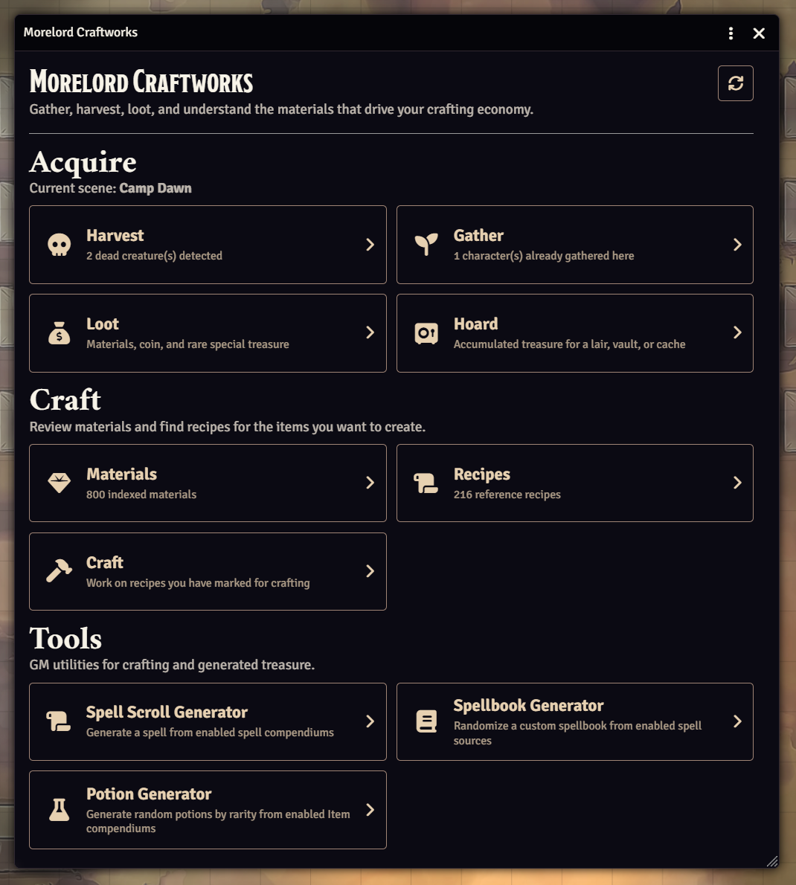

# Morelord Craftworks Documentation

Requires **Morelord Core 0.9.5 or later** for the Morelord Tools scene control, shared material-source cards, action pills, image links, and coin conversion. Update Core before Craftworks. Core 0.9.1 does not include the currency API this version calls.

## Overview

Morelord Craftworks brings harvesting, gathering, encounter loot, treasure hoards, materials, recipes, and crafting workflows into Foundry Virtual Tabletop. Players can browse a campaign's material and recipe catalogs, plan projects, and take part in GM-started acquisition sessions. Game Masters can configure content packs, tune acquisition rules, generate treasure, and create potions, spell scrolls, and spellbooks.

Craftworks keeps materials as normal dnd5e Items. They can live in a character's inventory or in a shared Group actor, allowing a party to gather resources together while a specific character supplies the tools, proficiency, and checks for a crafting project.

Standard material and SRD 5.2 content works without a Morelord Gaming account. Other content packs and completed crafting workflows may require the corresponding Morelord Gaming entitlement and installed source content.

Craftworks can also support exceptional add-on content packs that go beyond the standard rules. **Monsters of Drakkenheim** is the featured example: when the required content and access are available, Craftworks can use creature-specific Harvestable Components, Drakkenheim material families, recipes, and special harvesting instructions while keeping the core Craftworks workflows familiar.

## See Craftworks in action

	Take a guided tour of harvesting, materials, recipes, and crafting workflows.

	<iframe
		src="https://www.youtube-nocookie.com/embed/qmcmKaunt40"
		title="Morelord Craftworks demo"
		loading="lazy"
		allow="accelerometer; autoplay; clipboard-write; encrypted-media; gyroscope; picture-in-picture; web-share"
		allowfullscreen
	></iframe>

	Additional Game Master demo.

	<iframe
		src="https://www.youtube-nocookie.com/embed/XFebMhTQEA8"
		title="Morelord Craftworks additional demo"
		loading="lazy"
		allow="accelerometer; autoplay; clipboard-write; encrypted-media; gyroscope; picture-in-picture; web-share"
		allowfullscreen
	></iframe>

## Choose a manual

- [Game Master Manual](gm-manual.md) — installation, world configuration, content synchronization, Harvest, Gather, Loot, Hoard, generators, [shared locations](gm-manual.md#shared-locations), exceptional content packs, and troubleshooting.
- [Player Manual](player-manual.md) — browsing materials and recipes, planning and completing crafting projects, Harvest, Gather, shared party storage, and optional Drakkenheim content.

These manuals describe Morelord Craftworks 0.5.8 for Foundry Virtual Tabletop v14 and dnd5e 5.3 or later. The in-Foundry **Documentation** button on the Craftworks dashboard opens the current product guide through Morelord Core.

Page sections use Morelord Core bordered, shaded surfaces with shared padding, section headings, and spacing, matching Downtime. Older screenshots illustrate the workflows but may show the previous panel styling or omit the new add/remove controls. Refer to the manual text for current controls.

Version 0.4.16 adds a Harvest walkthrough showing one creature at a time beside a personal claim ledger. Non-Drakkenheim creatures use individual checks, while Drakkenheim and GM-skipped checks open directly to claims. Next advances; Skip Remaining and Done notify the GM of character completion. Requires Morelord Core 0.4.0 or later.

### Harvest skill check options

In the GM Harvest preflight, **Skill Checks** offers two mutually exclusive checkboxes, both unchecked by default:

- **Skip Skill Checks**: characters choose components without rolling. No natural-20 bonus is granted.
- **One Check for All Creatures**: each character rolls once for the session. The check happens before creature navigation and uses the lowest Harvest DC among the selected creatures. Success unlocks components across all creatures; failure shows **Failed to recover any components** with only **Done** available; the optional natural-20 bonus still applies. The recorded roll survives retries and reopened windows.
- Leave both unchecked to require a separate check for each non-Drakkenheim creature. Selecting either option clears the other.

Drakkenheim creatures require no separate creature check; the single session check covers all creatures when **One Check for All Creatures** is selected. Characters still use Next, Skip Remaining, and Done to navigate and finish; claims are awarded only when the GM selects Finalize Harvest. Offline characters can be handled through Roll as GM. These choices apply to the Harvest being started and do not change an active session.

### Delerium Search skill choices

Delerium Search opens a character-specific window using the same layout as Gather: character portrait, a Search Check panel with **Arcana**, **Investigation**, and **Survival** skill buttons and signed bonuses, followed by **Decline** and **Close** footer actions. Select a skill to open the native D&D5e roll dialog, where advantage, disadvantage, and roll adjustments are configured. Cancelling leaves the search pending. **Decline** submits no roll. The GM summary offers **Reopen Search / Roll as GM** for pending characters; it reopens the connected player's window or opens it for the GM when that player is offline. The GM can use the same controls for offline characters, including players who disconnect while a request is pending. Each character resolves only once; search results and awards keep their existing visibility.
