# Morelord Craftworks Game Master Manual

Morelord Craftworks gives a dnd5e world a connected system for harvesting creatures, gathering by terrain, generating encounter loot and hoards, managing materials and recipes, and running long-term crafting projects.

This manual applies to Morelord Craftworks 0.5.2, Foundry VTT v14, and dnd5e 5.3 or later.

## Contents

- [Feature access](#feature-access)
- [Install and activate](#install-and-activate)
- [Open Craftworks](#open-craftworks)
- [Configure content and storage](#configure-content-and-storage)
- [Configure acquisition rules](#configure-acquisition-rules)
- [Manage materials and recipes](#manage-materials-and-recipes)
- [Shared Locations](#shared-locations)
- [Run Harvest](#run-harvest)
- [Run Gather](#run-gather)
- [Generate encounter loot](#generate-encounter-loot)
- [Generate a treasure hoard](#generate-a-treasure-hoard)
- [Use the item generators](#use-the-item-generators)
- [Exceptional content: Monsters of Drakkenheim](#exceptional-content-monsters-of-drakkenheim)
- [Troubleshooting](#troubleshooting)

## Feature access

| Feature | Standard | Corresponding premium access |
| --- | :---: | :---: |
| Craftworks Standard materials | Yes | Yes |
| SRD 5.2 content when available | Yes | Yes |
| Materials and Recipes browsers | Yes | Yes |
| Harvest, Gather, Loot, and Hoard | Yes | Yes |
| Recipe planning and progress display | Yes | Yes |
| Complete crafting execution | No | Yes |
| Premium content packs | No | Yes |

Premium access is managed by Morelord Core. A content pack may also depend on official Foundry content installed in the world. Enabling a pack does not grant access to a source product.

## Install and activate

### Requirements

- Foundry Virtual Tabletop v14
- dnd5e 5.3 or later
- Morelord Core 0.9.0 or later. Update Core first, then refresh every connected GM and player client after updating Craftworks so each client registers the current source-availability socket handler
- SocketLib 1.1.3 or later
- Morelord Craftworks 0.5.2 or later

### Install with the manifest

1. On Foundry's Setup screen, open **Add-on Modules**.
2. Select **Install Module**.
3. Paste this manifest URL into **Manifest URL**:

   `https://raw.githubusercontent.com/tmoreland72/morelord-craftworks/main/module.json`

4. Install the module.
5. Open the intended world and choose **Manage Modules**.
6. Enable **SocketLib**, **Morelord Core**, and **Morelord Craftworks**.
7. Save the module configuration and reload when prompted.

## Open Craftworks

Open **Morelord Tools** on the left side of a scene and select **Morelord Craftworks**. The dashboard groups its tools into three areas:

| Area | Tools |
| --- | --- |
| **Acquire** | Harvest, Gather, Loot, Hoard |
| **Craft** | Materials, Recipes, Craft |
| **Tools** | Magic Item Generator, Potion Generator, Spell Scroll Generator, Spellbook Generator |

Acquisition and generator tools are GM-operated. Players can use the reference and crafting tools available to them and receive interactive Harvest or Gather windows when the GM starts a session.

Every Craftworks page has a **Documentation** button. Sections use the shared title and description layout; the page scrolls as a whole, with bottom actions in a separate footer. Recipe dialogs and catalog pickers use the same Core styling.

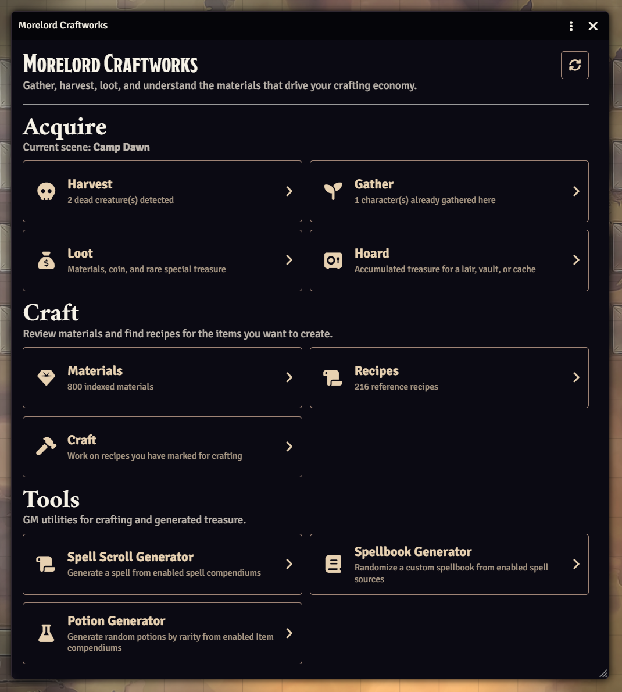

## Configure content and storage

Open **Game Settings → Configure Settings → Module Settings → Morelord Craftworks**, then select **Configure Craftworks**.

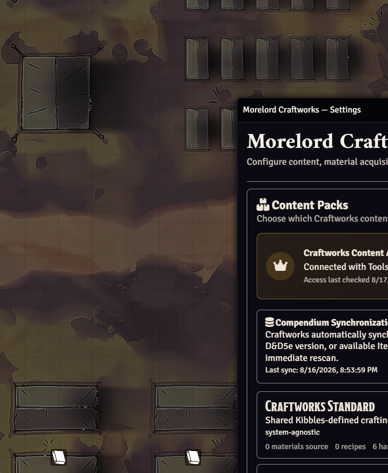

### Account and content access

The access panel shows the Morelord Core connection, current access tier, and most recent entitlement state. Use **Manage Account** to change the connection and **Refresh** after an account or subscription change.

Craftworks Standard, SRD 5.2, and SRD 5.1 are enabled by default in a fresh world and do not require authentication. Premium packs remain unavailable until their requirements are satisfied. A world that has already saved an SRD pack as disabled keeps that saved choice.

### Content Packs

Enable only the packs that should contribute to the campaign. Depending on installed sources and access, the list can include:

- Craftworks Standard
- SRD 5.2
- SRD 5.1
- Player's Handbook
- Dungeon Master's Guide
- Drakkenheim

An active pack can contribute materials, recipes, Harvest and Gather profiles, encounter-loot rules, economy profiles, and crafting definitions. Disabled or unavailable packs contribute no runtime content.

Each content pack card shows the pack name, its access badge, availability, a short description, the rules version, and an **Enabled** or **Disabled** control. Cards for packs that depend on installed modules, such as Drakkenheim, also list those modules and each module's availability. The cards do not list material, recipe, harvest, gathering, loot, or encounter counts.

**Available** on Craftworks Standard, SRD 5.2, and SRD 5.1 means the pack does not need another module. It does not mean the pack is turned on. The **Enabled** or **Disabled** checkbox is the saved world setting. Check the box and use **Save Changes** to turn a pack on. The first time a GM loads Craftworks in a world, Craftworks Standard and SRD 5.2 are saved on. That step does not run again, and it does not change SRD 5.1. SRD 5.1 uses its default of enabled until someone saves the Content Packs section.

When the same recipe is in more than one enabled book, Craftworks loads that recipe once, from the highest-priority source that has its finished item. Setting and third-party packs such as Drakkenheim win, then the Dungeon Master's Guide, then the Player's Handbook, then SRD 5.2, then SRD 5.1. Disabling a pack lets the next enabled source supply the recipe. The dashboard **Recipes** total counts those unique loaded recipes. A custom recipe created in the world is included in that total.

Some SRD recipe titles omit the creator name the handbooks use. When a book's item index has exactly one document named `<Name>'s` plus the recipe title, that document is the finished item. That rule links **Feather Token (Bird)**, **Feather Token (Swan Boat)**, and **Feather Token (Whip)** to Quaal's feather tokens, **Handy Haversack** to Heward's Handy Haversack, and **Instant Fortress** to Daern's Instant Fortress. A title with two prefixed documents in the handbooks stays unmatched. These explicit pairs also share one recipe: **Crawler Mucus** and Carrion Crawler Mucus, **Efficient Quiver** and Quiver of Ehlonna, **Restorative Ointment** and Keoghtom's Ointment, **Belt of Stone Giant Strength** and Belt of Giant Strength (stone), and **Belt of Storm Giant Strength** and Belt of Giant Strength (storm). Efficient Quiver does not link to the mundane Quiver. With the Dungeon Master's Guide enabled, that book supplies these recipes. Turning it off leaves the SRD copy.

The recipe catalog does not include **1st-Level Spell** through **9th-Level Spell**. Those nine generic scroll outputs overlap the per-spell scroll items, and the handbooks do not have a separate item for each of those levels. **Cantrip** remains, as does each Drakkenheim **Spell Scroll** tier recipe.

Ingredients stay with the recipe. A book pack does not have its own material list; Kibbles materials still come from Craftworks Standard, and Drakkenheim materials still come from the Drakkenheim pack, whichever book won the finished item.

With Craftworks Standard, SRD 5.1, SRD 5.2, Player's Handbook, Dungeon Master's Guide, and Drakkenheim all enabled, and with those item compendiums installed and enabled in dnd5e **Configure Sources**, the dashboard total is **279**: SRD 5.1 supplies 4, the Player's Handbook supplies 55, the Dungeon Master's Guide supplies 144, and Drakkenheim supplies 76. SRD 5.2 adds no further recipe while the Dungeon Master's Guide is enabled. The four SRD 5.1 recipes are **Saddle, Exotic**, **Saddle, Pack**, **Saddlebag**, and **Merchant's Scale**, which have no matching handbook item. Recipe linking uses a book's item compendium only when **Configure Sources** allows that compendium. A recipe whose finished item comes from a compendium that is off there is omitted from the catalog, the crafting list, and the dashboard **Recipes** total. Craftworks does not leave the card up with the item link removed. An ingredient name is resolved only in that recipe's source book. It is not replaced with the same name from another pack. Changing **Configure Sources** rebuilds the recipe and material indexes and refreshes open Craftworks windows. Turning the compendium back on lists the recipe again. A custom recipe remains in **Recipe Manager** so its output can be pointed at an allowed item; it stays out of the catalog while that output compendium is off. If the SRD item compendiums are not installed, or those compendiums are disabled in **Configure Sources** or in the SRD content packs, those four recipes are absent and the total is 275. The renamed items above still load from the Dungeon Master's Guide when that compendium is allowed.

The Drakkenheim card keeps one enable/disable control and a Champion badge, with separate availability statuses for Dungeons of Drakkenheim and Monsters of Drakkenheim.

### Synchronize compendiums

Craftworks automatically synchronizes when the first active GM enters the world and a relevant content signature has changed. The signature includes Craftworks and dnd5e versions, enabled content packs, Item compendiums allowed by dnd5e **Configure Sources**, and versions of active modules that supply those Item compendiums.

**Save Changes** saves the settings and waits for a fresh compendium sync before closing. If synchronization fails, saved settings remain and the window stays open with an error so you can retry. Select **Sync with Compendiums** after installing or updating source content, changing dnd5e's configured sources, or troubleshooting a missing material or recipe. Synchronization updates Craftworks material compendiums, refreshes external Item discovery, and rebuilds the recipe index.

Generated compendium-backed rewards respect the dnd5e **Configure Sources** selection. A disabled source is excluded when results are generated and checked again before an award is committed.

### Choose the acquisition recipient

By default, Harvest and Gather materials go to the participating character. To centralize resources:

1. Enable **Use Party Actor for Acquired Materials**.
2. Choose a dnd5e Group actor under **Party Recipient Actor**.
3. Save the configuration.

The selected Group actor becomes the default recipient for supported acquisition awards. Loot and Hoard also let the GM choose from player characters and Group actors before awarding a result.

## Configure acquisition rules

### Harvesting

| Setting | Effect |
| --- | --- |
| **DC Modifier** | Adjusts every calculated Harvest DC. |
| **Minimum Choices** | Sets the lower bound for component choices. |
| **Maximum Choices** | Sets the upper bound for component choices. |
| **Rare Result Bias (%)** | Shifts random choices toward rarer components. |
| **Natural 20 Grants Two Claims** | Gives a second claim when the active d20 is a natural 20. |

### Gathering

| Setting | Effect |
| --- | --- |
| **Global DC Modifier** | Adjusts every terrain's Gather DC. |
| **Quantity Multiplier** | Multiplies awarded material quantities. |
| **Rare Result Bias (%)** | Shifts successful results toward rarer materials. |
| **Terrain Gather DCs** | Overrides the source-pack DC for individual terrains. |

The final Gather DC is the terrain value plus the global modifier.

### Encounter Loot

The Loot settings independently enable materials, coin, and special treasure. Chance modifiers tune the frequency of each category, while material-quantity and coin multipliers adjust result sizes.

Potion and spell-scroll rewards use enabled dnd5e Item sources. Material components remain the most common results and potions are more common than spell scrolls.

## Manage materials and recipes

### Browse large catalogs

In **Craft**, clicking a crafted item's image opens that recipe in **Recipes** with the selected crafter retained. Clicking a specific material ingredient's image opens that entry in **Materials**. The actions are labeled **Open [recipe name] recipe** and **Open [material name] material** and support keyboard activation. Generic requirements without a single identifiable material keep a passive image. **Recipes (N)** on a material card opens **Recipes** filtered to enabled recipes that accept that material by ID, name, tags, category, stage, rarity, or alternatives, including Drakkenheim component family, part, creature type, and rarity. The count is the number of those recipes. Players see only recipes they know. The button is omitted when that list is empty. Unresolved catalog outputs from disabled packs are not included. **Clear all filters** returns to the full catalog. Output-only recipes remain under **Produced by**.

Materials and Recipes use a search field and persistent filter rail. Facets cycle through three states:

| Symbol | State | Meaning |
| --- | --- | --- |
| Empty circle | Any | This value does not affect the result. |
| Plus | Include | Results must match the value. |
| Minus | Exclude | Matching results are removed. |

Search and filter totals always reflect the complete catalog. The browser initially renders up to 300 matching cards to keep very large catalogs responsive.

Materials can be filtered by source pack, rarity, category, processing stage, and material tags. Recipes add filters for recipe/output rarity and knowledge state.

GMs can click the orange, white-text **Gather**, **Harvest**, or **Loot** pills on a material card to open **Material Sources**. Players see passive tags. Standard acquisition pills reflect the active rules, rather than stored catalog flags: processed leather does not show Harvest, and materials without a gathering terrain do not show Gather. **Gather** lists matching terrains. **Harvest** lists creature types, sizes, CR ranges, and required traits; each description shows the harvest category. Repeated results are merged. Fallback entries are labeled **Fallback only** and apply when trait-based harvesting yields no components. The passive **Craftable** pill means an enabled recipe produces the material; **Produced by** lists those recipes. It does not mean the selected actor currently meets their crafting requirements.

For Drakkenheim materials, **Harvest** searches the installed Monsters of Drakkenheim compendium. Family references include specific components of the same family, creature type, and rarity: **Bones - Aberration (Legendary)** includes The World Ender's bones and The Duchess's skull. A specific Skull reference never includes a Spine-only source. This reference grouping does not change the component actually awarded by harvesting. Named results use the shared Encounters monster card: portrait, name, CR, source, and an **Open [name] Actor sheet** icon action, without Regenerate. Results show relevant component/form rarity and component names; unrelated special-item and delerium instructions remain in harvesting and are omitted here. This requires the enabled Drakkenheim content pack and its installed monster compendium. Ordinary materials do not search or mention Drakkenheim. **Searching…** and the monster count indicate an unfinished lookup; unavailable or unreadable content is reported separately.

The first Drakkenheim search builds an in-memory source index shared by subsequent material searches on that client. Concurrent searches share the same build. Material-catalog synchronization or changes to Drakkenheim Actor and Journal documents invalidate it. World restarts and browser reloads clear it automatically; it is not stored in world settings. Failed or incomplete builds are retried on the next search rather than cached as an empty result.

Both GM and player Materials browsers use GM-verified Drakkenheim availability for Harvest tags. **Checking monster harvest sources…** appears during the initial check; Harvest is shown only once a matching source is confirmed. Players request only the verified material IDs through Craftworks' socket service; monster identities and source text remain GM-only. Players need a connected GM for a fresh check. Unverified catalog flags are never used as a fallback, including while loading or when verification fails. Relevant source changes invalidate player availability and refresh open browsers. Catalog-only variants without a source do not offer a Harvest tag. For example, the installed dragons list claws and teeth rather than horns, and the installed ratling harvest rarities range from Common to Rare. Source matching includes creature subtype and the source journal's name, so a Ratlings page can identify a ratling whose Actor name omits that word.

During GM catalog indexing, Craftworks repairs its five known invalid built-in artwork paths on its own world-compendium Items. This fixes both Materials cards and the native Item sheets, preserves compendium locking, and leaves custom artwork and other packages' Items unchanged.

The **Loot** pill appears only for materials with a positive-weight result in the active material loot tables; a stored catalog Loot flag alone does not display it. Disabling a content pack removes its unsupported Loot pills. **Loot** lists **Any creature** with the matching CR bands and source pack. Actual drops also require material rewards enabled in Loot settings. **Documentation** opens the module documentation on the Morelord Gaming website; **Close** dismisses the source window. These lookups do not roll, award items, or alter creatures.

Standard material loot now includes all 172 Standard catalog materials. Newly added Trivial/Common materials appear in CR 0–4, Uncommon in CR 5–10, Rare in CR 11–16, and Very Rare/Legendary in CR 17+. The pools contain 116, 25, 18, and 25 distinct results respectively, including retained original results. Original quantities and weights remain; additions yield one unit with weight 2. The material-drop chance is unchanged, but the broader pools change each material's selection odds. Creature type does not restrict material loot; gathered and processed goods can be found among possessions.

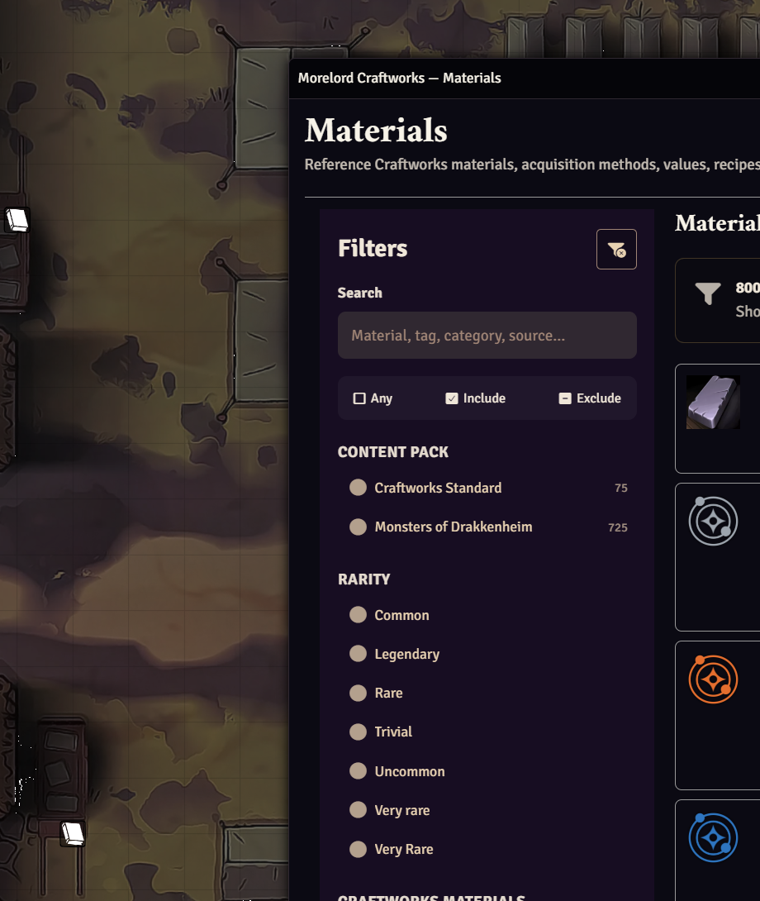

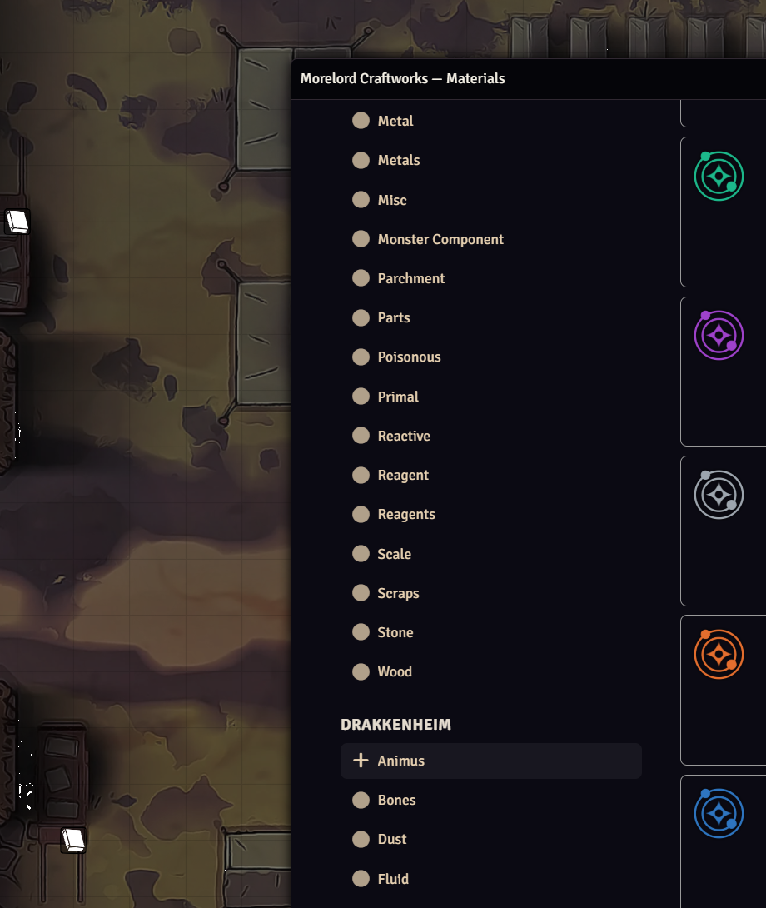

Every recipe filter displays its catalog count, including Knowledge, Content Pack, Category, Preferred Artisan Tool, Rarity, and ingredient tags. Counts describe the visible enabled catalog.

Craftworks crafting checks use the listed artisan tool at the recipe’s DC. Missing either the tool in the crafter’s inventory or its proficiency imposes disadvantage; it never increases the DC. The underlying ability still supplies the tool roll modifier and can be chosen in the native roll dialog. Recipes with an explicit skill and no tool retain that skill. Monsters of Drakkenheim recipes, including custom Drakkenheim recipes, require no crafting roll: supply the materials and use a Workshop of the item’s rarity or higher, then choose Craft Item. That Workshop requirement is independent of the artisan-tool facility settings. [Shared Locations](#shared-locations) explains the tier, Specialty, and what players see when the place does not qualify. Drakkenheim crafting has no time requirement, including when resuming an older saved crafting job.

### Control recipe knowledge

Recipes are either **Known** or **Unknown**. An Unknown recipe remains discoverable and can be marked as a crafting goal, but its ingredient requirements are concealed from players and a player cannot begin a new job from it. When a GM loads the world, stored Unknown ids that no longer match a packaged or custom recipe are removed. Ids for recipes in a pack that is currently disabled are kept.

Use **Mark Context Known** or **Mark Context Unknown** to update only the recipes matched by the current search and filters. This makes it possible to reveal a family of recipes without changing unrelated entries.

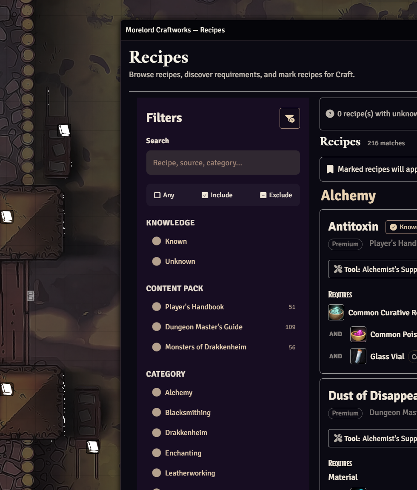

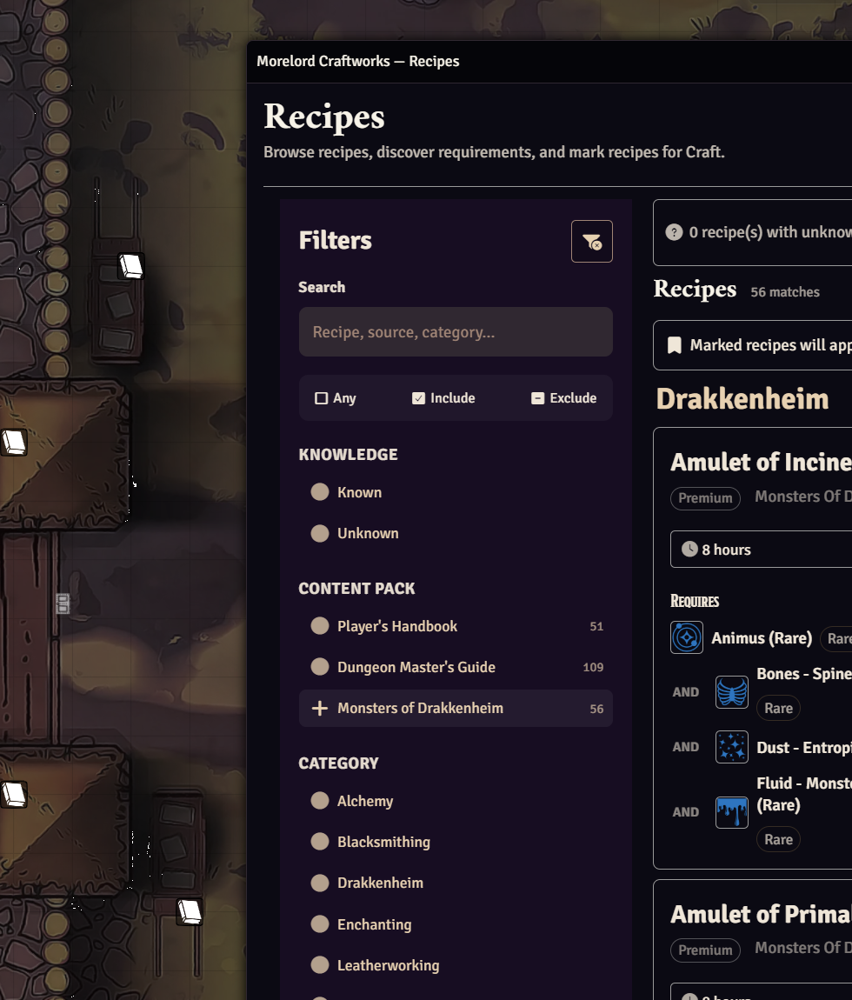

### Create and manage custom recipes

The Harvest creature selector uses the same whole-row selection as Encounter Loot: click the creature’s name, portrait, or row to check or uncheck it.

Open **Recipe Manager** from the dashboard. Choose **New Recipe**, or **New Drakkenheim Recipe** when that content is available. The first section, **Item to Be Crafted**, selects the item with the full filtered catalog picker. Then set its quantity, artisan tool, crafting hours, tool ability, and DC. **Add Required Group (AND)** adds another mandatory requirement. **Add Material Choice (OR)** offers another material within that group. For example: Animus AND (Spine OR Ribs) AND Dust. Existing alternative complete recipes retain their original logic when edited. The Drakkenheim editor explains its no-check and no-time rules in a callout beneath Crafting Check; the Workshop requirement still applies. Save the recipe to make it available in the catalog.

The manager supports editing, deleting, exporting individual recipes or all recipes, and importing JSON. Import conflicts can be skipped or replaced. Standard and Drakkenheim recipes keep their material catalogs separate.

### Understand crafting context

The **Crafter** performs checks and supplies tool possession and proficiency. The **Ingredient Inventory** supplies ingredients and receives the output. GMs retain the inventory selector. For players, Craft automatically combines the selected character’s inventory with all Groups that character belongs to; ingredients may be split between those inventories. Other characters’ inventories are excluded. Cancellation returns ingredients to their original inventories.

When crafting finishes, the crafter chooses **Place in My Inventory** or **Place in {party name} Inventory**. Placing the item resets that recipe’s successes, hours of progress, and hours spent on the recipe card to 0. The craft log keeps the completed attempt. Downtime still reads the hours spent on the saved job. A player who belongs to the party Group can choose the party inventory without owning that actor. The connected GM creates the item on the Group. The placement runs once for that completed job.

Crafting progress belongs to the crafter-and-recipe combination and does not split when the inventory source changes. Each attempt represents two hours. Failed checks consume time but not recipe materials. Recipe durations must be positive multiples of two hours.

Facility requirements come from Morelord Core’s shared locations. In **Configure Craftworks → Crafting**, each artisan’s tool can require a location activity or **No facility required**. [Shared Locations](#shared-locations) explains that check, the tool map, Workshop specialties, and the messages players see when a place blocks a job. **Manage Locations** on the dashboard opens the Core location window. An explicit Downtime session location replaces the viewed scene. A session set to **No Location** keeps the location associated with that scene. A job pauses while its facility is unavailable and resumes when the requirement is met.

Craftworks exposes marked and active crafting projects to Morelord Downtime. Opening one from Downtime launches a focused Craft window for that crafter and recipe while Craftworks remains authoritative for ingredients, checks, progress, and output.

Standard Craftworks recipes advance through two-hour crafting attempts. Starting a project sets the chosen materials and items aside from inventory. Successful checks advance progress. The recipe card never shows more successes than the craft requires. A failed check spends the two hours and does not advance the project. Those materials and items are not lost. They stay set aside for the next attempt. On the recipe card, each reserved ingredient in **Requirements** shows a **Set aside for this craft** badge with the quantity held. The section also says: Materials are set aside, not lost, until the craft finishes or is abandoned. **Cancel** returns them to the inventories they came from. The Craft window and the failed check’s chat card both say so. Recipe cards show the artisan tool and recipe DC. Missing tool possession or proficiency imposes disadvantage at that same DC. Drakkenheim recipes complete without a roll once their requirements are met.

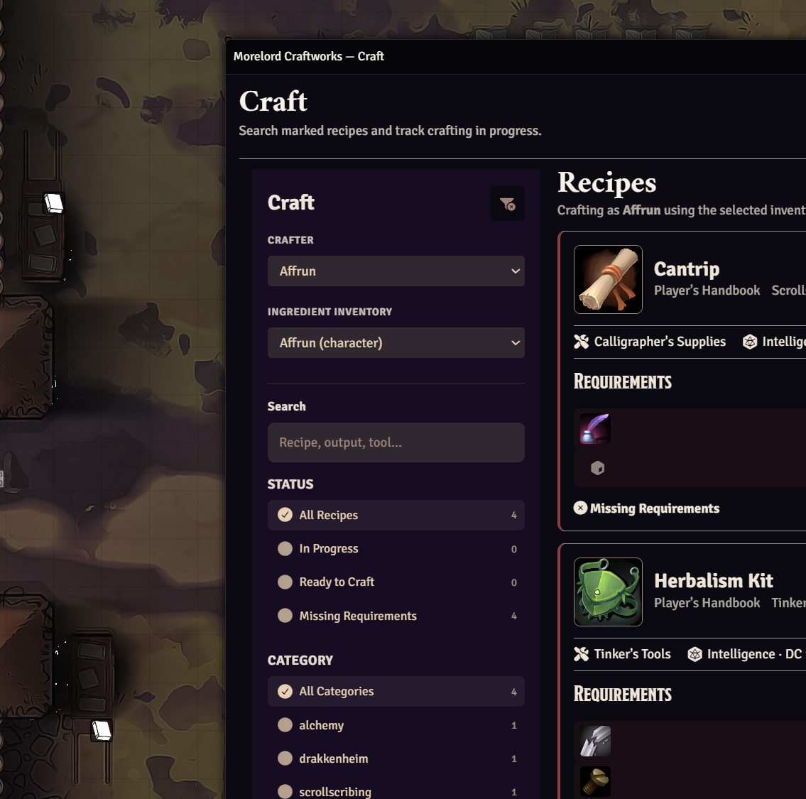

## Shared Locations

Craftworks reads the current place from Morelord Core’s shared locations. A shared location names a place, the scenes that use it, and the facilities available there. Creating a location does not create recipes, tools, or crafting jobs. This section explains how Craftworks uses a place. Setup of the place itself is in Core’s Shared Locations guide, linked at the end of this section.

### Which place is checked

Craftworks asks Morelord Core for the active place of the person who is crafting.

- With no active Downtime session, the place is the shared location associated with the scene that person is viewing.
- An active Morelord Downtime session that has a location replaces the scene. Craftworks uses that session location.
- A session set to **No Location** keeps the shared location associated with the viewed scene.
- **On the Road** applies when that session has **No Location** and the viewed scene has no associated location. On the Road has no facilities.

**Manage Locations** on the Craftworks dashboard opens Core’s location window. The same window is **Morelord Core → Manage Shared Locations** in Core’s module settings.

### Facility rules in Crafting settings

Open **Game Settings → Configure Settings → Module Settings → Morelord Craftworks**, select **Configure Craftworks**, and find the **Crafting** section. Each artisan’s tool has its own dropdown. **No facility required** is the first choice. The other choices are the activities Morelord Core has registered, except Alchemist. Alchemist is a Workshop specialty, not its own activity, so the dropdown does not list it. The built-in activities are Forge, Marketplace, Library, Temple, Contractor, Instructor, and Workshop. An activity that has specialties is a group. The activity name alone, such as **Workshop**, means that activity with any specialty. **Forge** is only the activity. Craftworks reads the forged item’s own category, so the dropdown does not list Forge categories. A saved Forge specialty, including one that named a weapon, armor, or category, is kept as **Forge**. Workshop lists its tools in the **Workshop** group, including **Workshop: Alchemist's Supplies** and **Workshop: Leatherworker's Tools**. Instructor uses its language, skill, tool, weapon, armor, and weapon mastery groups. A saved choice that is only the activity, such as `workshop` or `forge`, stays that activity. A saved `alchemist` setting is kept as `workshop:alchemist`. The field stores one activity or one Workshop or Instructor specialty.

The list uses the D&D 2024 artisan’s tool names, and **Smith's Tools** appears once. A facility rule saved under the older name Blacksmith's Tools still applies to **Smith's Tools**, including a custom recipe that still stores that name. A recipe whose tool is outside the standard list, such as Cartographer's Tools, adds that tool to the **Crafting** list.

Every tool starts as **No facility required**. A standard recipe left that way can be worked in any place, including On the Road. **Assign Defaults** fills the standard map and does not save until you select **Save Changes**. **Alchemist's Supplies** and **Poisoner's Kit** become **Workshop: Alchemist's Supplies**. The other artisan’s tools become the matching Workshop specialty, and **Smith's Tools** becomes **Forge**. **Clear All** sets every tool back to **No facility required**, also without saving until **Save Changes**. If any tool already has an assignment, Craftworks asks before replacing it. **Assign Defaults** and **Clear All** use Core’s compact Yes/No confirmation. **Yes** applies the change. **No**, and closing the window, leaves the assignments as they are. **Clear All** offers **No** as the default. Recipe editors have no separate facility control. The recipe shows the activity chosen for its tool.

The required tier is the rarity of the item being crafted. Craftworks reads Common, Uncommon, Rare, Very Rare, Legendary, and Artifact. “Very Rare” is one tier. A rarity Craftworks does not recognize is treated as Common. A higher tier of the same activity qualifies, so an Uncommon item can use an Uncommon, Rare, Very Rare, or Legendary facility of that activity. Each requirement names one activity, and only a row of that activity can meet it. Settlement size does not change the tier.

Core’s location tiers are Common, Uncommon, Rare, Very Rare, and Legendary. An Artifact item that requires a facility has no matching Core tier. Craftworks reports `No artifact facility tier is available in Core.`

Monsters of Drakkenheim recipes, including custom Drakkenheim recipes, always require a Workshop of the item’s rarity or higher, with any Workshop specialty. That requirement stands on its own, including when the tool’s **Crafting** dropdown is **No facility required** or another activity. Drakkenheim crafting still has no roll and no time requirement.

### What each activity checks

Craftworks checks the choice in **Crafting**, at the item’s tier or higher.

**No facility required** passes in every place.

Choosing **Workshop** alone accepts any Workshop of sufficient tier. The specialties stored on that Workshop do not matter. A Workshop limited to Cobbler's Tools can still craft a recipe whose tool is set to **Workshop**.

Choosing a Workshop or Instructor specialty, such as **Workshop: Leatherworker's Tools**, accepts a capability of that activity at a sufficient tier whose specialty includes that choice, or whose specialty is unrestricted. Craftworks uses the same match as Morelord Core: nothing selected, a blank value, and **Any** allow the specialty. Several checked specialties qualify together when the chosen one is among them. A specialty saved earlier as a single value still matches that one value. **Any** or a blank entry stored beside other specialties is ignored, and those other specialties are what count. A matching specialty on a row below the required tier does not qualify. An unrestricted row of sufficient tier does qualify, including when another row of that tier names a different specialty.

**Alchemist's Supplies** and **Poisoner's Kit** use **Workshop: Alchemist's Supplies**. A recipe for either tool needs a Workshop of sufficient tier whose specialty includes Alchemist's Supplies or is **Any**. A location that only has the older Alchemist activity does not qualify. A saved tool setting of `alchemist` is read as `workshop:alchemist`. The warning reads `Requires common workshop (Alchemist's Supplies or Any).` when the item is Common.

**Forge** is different. Every recipe whose tool requires Forge, including a tool set only to **Forge**, takes its category from the crafted item. A longsword needs a Forge whose specialty is Weapons, Martial Weapons, Martial Melee Weapons, or **Any**. Splint needs Armor, Heavy Armor, or **Any**. A parent covers its children. A child does not cover its parent. An item that is not armor, a weapon, or ammunition, such as tongs, can use any Forge of sufficient tier. The tool setting does not add another Forge category.

### Assigned specialties

The dropdown’s specialty choices come from Morelord Core. Workshop lists the workshop artisan’s tools and always includes **Alchemist's Supplies**, even when Core’s list does not yet. Instructor lists languages, skills, tools, weapons, armor, and weapon masteries. Forge and the other activities without a tool specialty offer only the activity. Alchemist is not one of those activities.

On a recipe card, a Workshop or Instructor specialty is named in parentheses, such as `(Leatherworker's Tools or Any)`. A Forge recipe names the item’s category instead, such as `(Martial Melee Weapons or Any)` or `(Heavy Armor or Any)`. After the dot, the card lists that activity’s specialties at the current place. Several names are separated by commas. When any row of that activity at the place has nothing selected, the card shows `Any`. When the place has no row of that activity, the card omits the place text. A Forge item with no category, and a Workshop choice with no specialty, have no parentheses.

The place text includes rows below the item’s tier. The check itself still requires a row of sufficient tier.

### What players see when the place blocks crafting

**Recipes** cards always include a **Facility** line. Examples:

- `No facility required`
- `Uncommon or higher Forge`
- `Rare or higher Workshop`
- `Common or higher Workshop (Leatherworker's Tools or Any) · Leatherworker's Tools`

The tier on that line is the item rarity, written Common, Uncommon, Rare, Very Rare, Legendary, or Artifact, followed by “or higher” and Core’s name for the activity.

In **Craft**, the same facts appear beside a location icon. That line uses the stored tier and activity id, for example `common workshop (Leatherworker's Tools or Any)` or `common workshop`.

When the place fails, a warning callout on the Craft card states the reason in these words:

- The activity is missing, its tier is too low, or the required specialty is not allowed: `Requires common workshop.` for a type-only Workshop, and `Requires common workshop (Leatherworker's Tools or Any).` when that specialty was chosen. A longsword reads `Requires common forge (Martial Melee Weapons or Any).` Splint reads `Requires common forge (Heavy Armor or Any).` A forged item with no category reads `Requires common forge.` Very Rare appears as `veryRare` in that warning and on the Craft line, and as `Very Rare` on the recipe **Facility** line.
- Core’s location service is missing: `Morelord Core Location services are unavailable.`
- The item rarity is Artifact: `No artifact facility tier is available in Core.`
- The recipe’s environment cannot be resolved: `This recipe cannot be worked in the current environment.`

The badge follows the job.

- The materials are ready, crafting has not started, and the place fails: **Environment Unavailable**. The footer reads **Missing Requirements**. **Start Crafting** and **Craft Item** stay hidden.
- The materials are also short: the badge reads **Missing Materials**. The place warning still appears.
- A job is already underway: the badge reads **Paused - Environment**. **Roll Crafting Check** or **Craft Item** is replaced by **Paused here**. **Cancel** remains.

Starting or continuing while the place fails shows that same sentence as a warning notification. An active job keeps its progress and the materials already consumed. It waits without a new roll and without finishing. When that character is later at a place that meets the requirement, the pause clears and the crafting button returns. A job that has not started consumes no materials while it is blocked.

### Where to create the places

Create the place in Morelord Core: set **Name**, **Settlement Type**, and **Notes**, then **Add Capability** for each **Type**, **Tier**, and **Specialty**, and associate scenes. The **Shared Locations** section of the [Morelord Core documentation](https://morelordgaming.com/docs/morelord-core) is the setup guide. From Craftworks, **Manage Locations** opens that same window. If Core’s location window is unavailable, Craftworks warns `Morelord Locations is unavailable. Update and enable Morelord Core.`

## Run Harvest

Harvest is a synchronized session in which players test their characters against defeated creatures and reserve components for a final award.

### Start the session

1. Keep defeated creature tokens on the active scene.
2. Open **Craftworks → Harvest**.
3. Review the detected defeated dnd5e NPC tokens.
4. Include actual harvestable creatures and exclude shopkeepers, traps, or other defeated NPC-based tokens.
5. Use **Select All** or **Clear All** when useful.
6. Review creature type, CR, Harvest DC, rarity, components, and special instructions.
7. Select the participating player characters. Defaults follow the primary populated party, then player-owned characters, and the last successful selection is remembered.
8. Select **Start Harvest**.

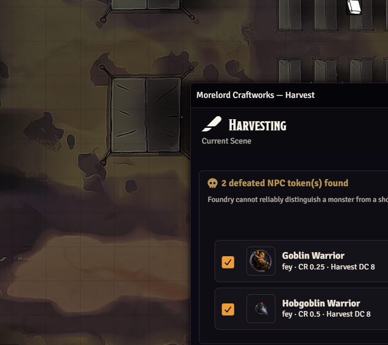

At least one defeated NPC and one player character must be selected. Each selected character controlled by a connected player receives an independent Harvest window. One user controlling two selected characters receives two character-titled windows with separate checks and claims. Offline characters receive a character-specific window on the GM’s client. Use **Roll as GM** to open it again and make checks or choose components on their behalf.

### Monitor checks and claims

Each character sees one creature at a time in the larger right panel and their own reserved components in the left panel. Non-Drakkenheim creatures require one **Roll Harvest Check** each. Success exposes component choices; failure consumes that character’s attempt for that creature. Drakkenheim creatures open directly to component choices without a skill check. Reopening restores the current creature and its recorded outcomes; retrying delivery does not reroll. Before starting, the GM can enable **Skip Skill Checks** in the Skill Checks section to send all included characters directly to component choices, including Drakkenheim harvesting. Skipping does not grant a natural-20 bonus or reset previous attempts. When checks are enabled, the optional natural-20 double-component bonus still applies.

A claim reserves a component but does not add it to inventory. Open Harvest windows synchronize reservations and claimants. Drakkenheim parts are exclusive; standard components can be harvested independently by each character.

**Next** replaces the current creature after its check and available claims are resolved. **Skip Remaining** ends the character’s remaining opportunities; on the last creature, **Done** is the only navigation button and can also finish without taking a remaining claim. Both finish actions mark that character **Harvesting Completed** in the GM’s progress view and close their window. Existing claims remain reserved for **Finalize Harvest**. Reopening a completed character shows their claim ledger without further checks or claims.

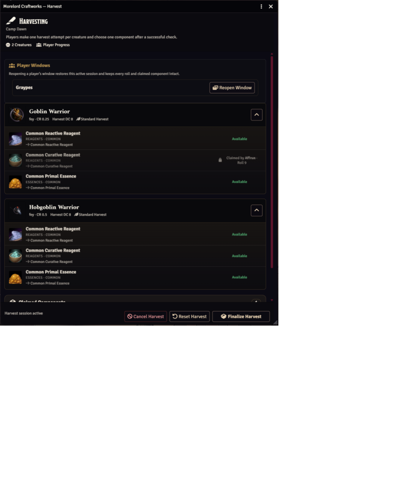

### Finalize, reset, or cancel

- **Finalize Harvest** awards reserved items, marks them delivered, creates one consolidated chat card per recipient, and closes the session.
- **Reset Harvest** clears attempt state so the scene can be harvested again. Unfinalized claims have not entered inventories.
- **Cancel Harvest** discards the session, clears its attempt state, closes the windows, and awards nothing.

Finalization is designed to avoid duplicate delivery if it is retried after an interruption.

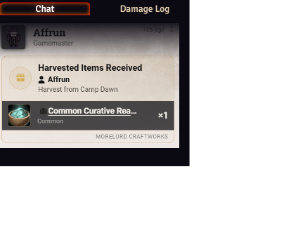

## Run Gather

Gather is a GM-started, scene-based opportunity for individual characters.

1. Open **Craftworks → Gather** on the intended scene.
2. Select the terrain profile.
3. Review the displayed DC and active participants.
4. Select participants using the same party-priority character picker as Harvest. The previous successful selection is remembered.
5. Start the session. Connected players receive independent character windows. Offline characters open on the GM’s client; **Roll as GM** reopens their Gathering window. The character’s skills and inventory recipient are used in either case.
6. Players choose an allowed skill and make the configured dnd5e roll, or decline.
7. Successful results award a material appropriate to the terrain.

Gather attempts are tracked per character and scene. Reopening the tool does not grant unlimited repeat attempts. Use the GM reset control only when the scene should offer a new opportunity.

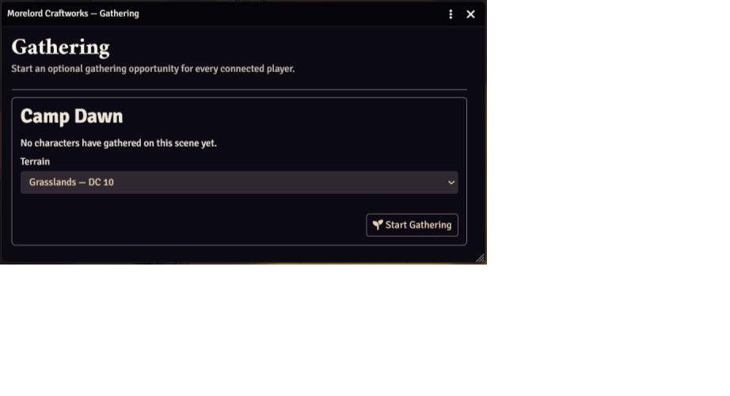

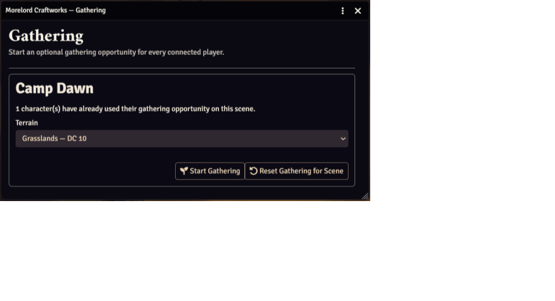

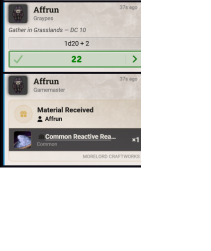

## Generate encounter loot

Loot is a party-level post-combat workflow and resolves applicable defeated creatures once for the encounter.

1. Open **Craftworks → Loot** on the scene containing defeated tokens.
2. Review the encounter creatures and generated **Encounter Haul**.
3. Open linked items when you need to inspect a result.
4. Use **Reroll** to replace the current generated result or **Reset** to clear the encounter's resolved state when appropriate.
5. Choose a player character or Group actor under **Recipient**.
6. Select **Award Encounter Loot**.

A result can include materials, coin, potions, spell scrolls, and special treasure. The final award is summarized in a consolidated public chat card with clickable item references.

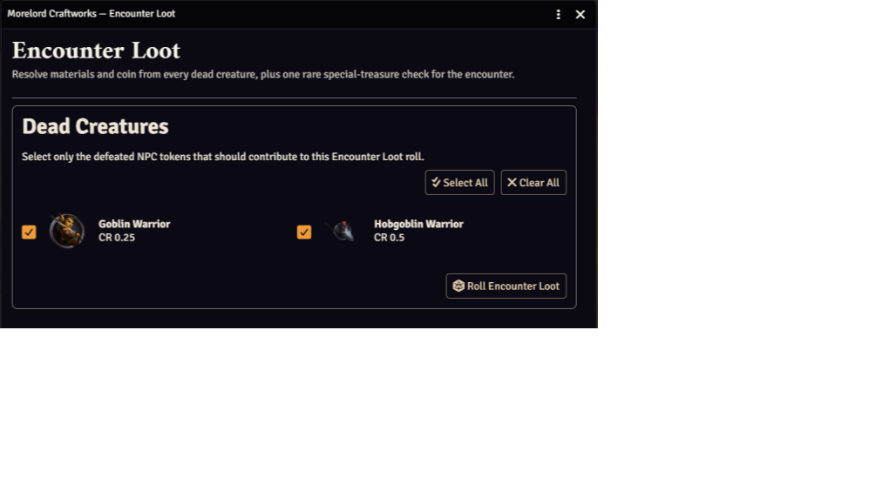

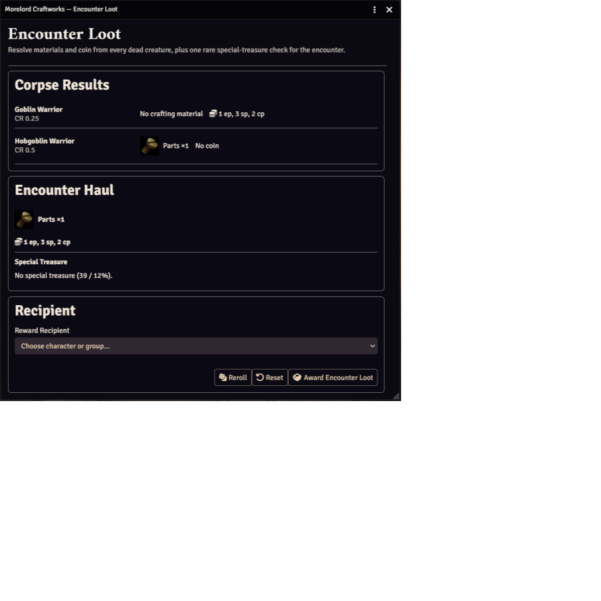

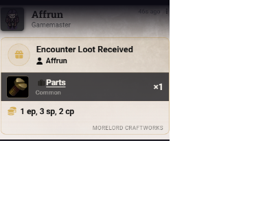

## Generate a treasure hoard

Use Hoard for a vault, cache, lair, reward chest, or other accumulated treasure rather than ordinary corpse loot.

1. Open **Craftworks → Hoard**.
2. Set the hoard's parameters and generate the result.
3. Review its materials, currency, potions, spell scrolls, and special treasure.
4. Choose a player character or Group actor.
5. Award the hoard.

Every generated hoard includes potion and spell-scroll rewards in addition to its other configured results. Awards produce a consolidated chat card.

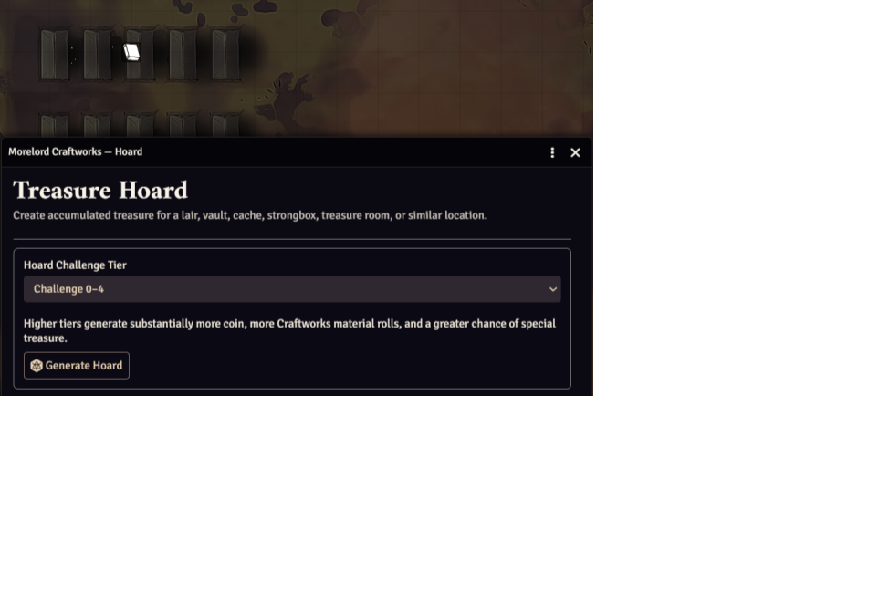

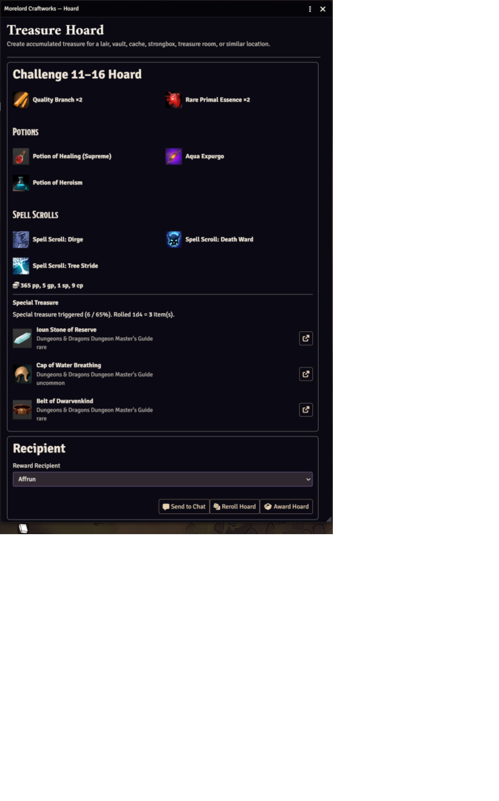

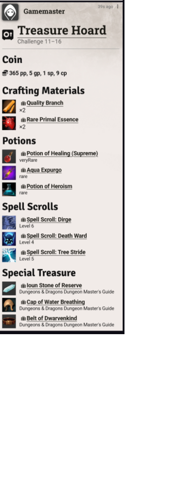

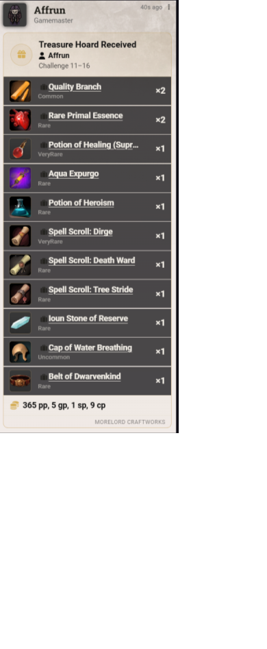

## Delerium Search

Enable the Drakkenheim Content Pack and its installed source module, then open **Delerium Search** under **Acquire**. Choose an area and participating characters. Connected players roll Arcana, Investigation, or Survival; the GM can roll for offline characters. The search takes one hour per quarter-mile hex. Outer City checks are DC 15; Inner City checks are DC 20. A success earns one success, or two when beating the DC by 5 or rolling a natural 20. Two failed character checks trigger a random encounter.

Use **Save as Default** to remember the search area and selected characters for future searches.

**What the Party Finds** lists cumulative rewards: 0–2 successes find nothing; 3 successes find 3d6 chips; 4 successes find 3d6 chips **and** 1d6 fragments; 5 or more find both of those rewards **and** one shard. Click the dice buttons for reference rolls in chat. These reference rolls do not award items or set the final quantity.

Select **Finalize Search**, choose a character or party Group under **Recipient**, and use **Roll & Award All Delerium**. This rolls each quantity and awards all earned original Delerium Chip, Fragment, and Shard items from the **Monsters of Drakkenheim** Item compendium. Open a reward to inspect its source document. A result can only be awarded once; if a delivery fails partway through, retry with the same recipient to finish the remaining rewards. When an encounter is required, the results window can open Morelord Encounters if it is active.

## Content-pack availability

Craftworks Standard, SRD 5.2, and SRD 5.1 display **Standard** tier badges alongside availability. This distinguishes Standard, Premium, and Champion access without changing any pack toggle or subscription rules.

The Player's Handbook and Dungeon Master's Guide retain their **Premium** subscription badges beside the independent availability indicators.

The **Player's Handbook** and **Dungeon Master's Guide** settings cards show **Available** when the corresponding official module is installed and enabled in this world, **Disabled** when installed but inactive, and **Not Installed** when absent. The **Drakkenheim** card shows **Champion** and keeps its enable/disable control. Its **Dungeons of Drakkenheim** and **Monsters of Drakkenheim** subheaders report each module's availability separately. This replaces the former setup callout. Subscription access still controls whether a paid content pack can be enabled; module availability does not grant a subscription.

## Lucky Finds

With Champion access and the Drakkenheim content pack enabled, install the official **Dungeons of Drakkenheim** module and choose **Acquire → Lucky Finds**. It rolls that module's table without changing its source data and opens a GM-only result window. Click dice formulas once for GM-only quantity rolls and click item links to inspect source documents; this does not automatically award inventory or currency.

Result 8 offers **1d4 artisan tools** with available linked tools to choose from. Result 12 links the DMG **Art Object (25 GP)**. Results 15–16 link **Keoghtom's Ointment**. Delerium always links to **Monsters of Drakkenheim → Magic Items**. Missing required items are called out rather than replaced with invented documents. Spell-scroll results, including 20, include **Generate Spell Scroll**, opening the existing generator directly; select the stated rarity's spell levels and quantity there.

To roll at combat completion, import **Lucky Finds** into the world and configure **Morelord Game Master → Triggers → + New Trigger → Combat ends: roll Lucky Finds**. This optional integration coordinates one GM and skips the roll if the world table is absent. It does not make Craftworks a required Game Master dependency.

## Use the item generators

Each potion or scroll result defaults to **Quantity 1**. Change the result’s Quantity to award multiple copies of that item, such as three Potions of Healing. Sharing in chat and awarding both use the edited quantities. Quantities must be positive whole numbers; rerolling replaces the draft.

### Magic Item Generator

Open **Tools → Magic Item Generator**, select categories and a rarity, then select **Generate** to draw one random magic item from enabled D&D5e Item compendiums. This premium GM utility has no quantity controls, vendor name, or duplicate checkbox.

Items without a recognized magic-item rarity and nonphysical documents are excluded. Legacy rarity fields and D&D5e v6 rarity sets are supported; multi-rarity items use their lowest rarity, matching the shared Core item reader. Duplicate names within the same category/rarity prefer the configured source priority. Add Item omits items already in the draft.

Open linked source Items, use **Add Item** to choose another item from the searchable catalog, remove entries, **Reroll**, or **Go Back** to change filters. **Display Results in Chat** shares the linked list. The draft lasts while the window remains open; generating and sharing do not change inventories.

### Potion Generator

Category changes immediately update the available counts for every rarity, including zero when all categories are disabled.

Open **Potion Generator**, choose quantities with the numeric fields or visible up/down controls, and generate a result from enabled dnd5e sources. Use **Display Results in Chat** to share a draft—such as a shop's current stock—without creating or awarding Items. To award it, choose a recipient and create the award. The source is validated again before delivery.

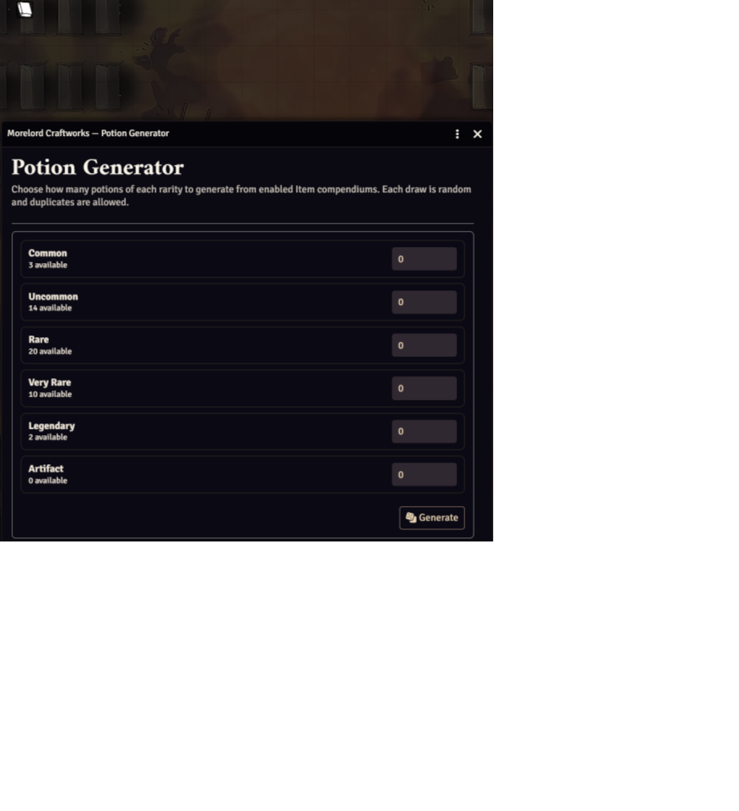

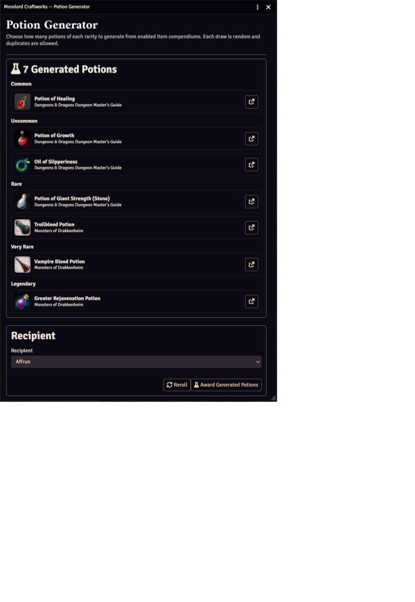

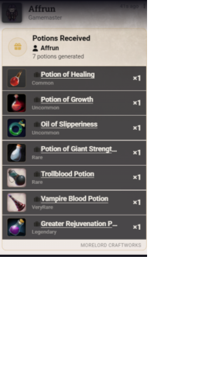

### Spell Scroll Generator

Below Schools of Magic, choose **Generate By → Spell Level** or **Rarity**. The modes keep separate quantities. Rarity mode draws each requested scroll from its matching levels: Common = cantrip–1, Uncommon = 2–3, Rare = 4–5, Very Rare = 6–8, Legendary = 9. School selections update availability in either mode; no schools selected means zero available spells.

1. Open **Spell Scroll Generator**.
2. Choose Spell Level or Rarity, then enter quantities with the numeric fields or +/− buttons.
3. Select **Generate** and review the random spells from enabled compendiums.
4. Open a source document when you need to inspect a result, or use **Reroll** to replace the draft.
5. Optionally select **Display Results in Chat** to share the draft without creating Items.
6. Choose the recipient.
7. Select **Award Generated Spell Scrolls**.

Generated scrolls use dnd5e's native scroll conversion, preserve the selected spell's usable mechanics, support levels above 1, and keep a link to the source spell. Craftworks also installs one scroll Item per spell into the Craftworks Spell Scrolls compendium. The recipe catalog does not add a separate generic recipe for spell levels 1 through 9.

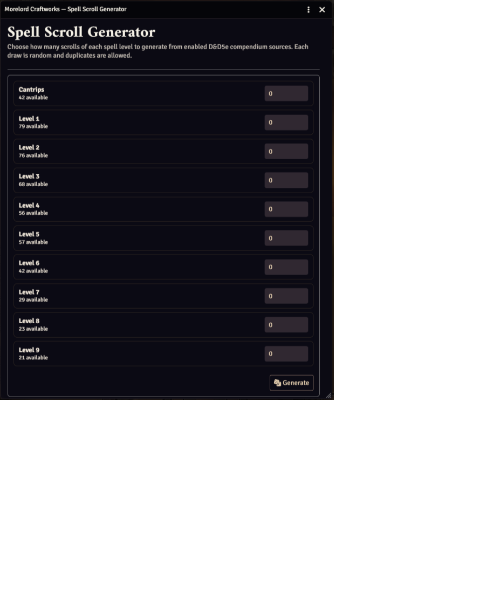

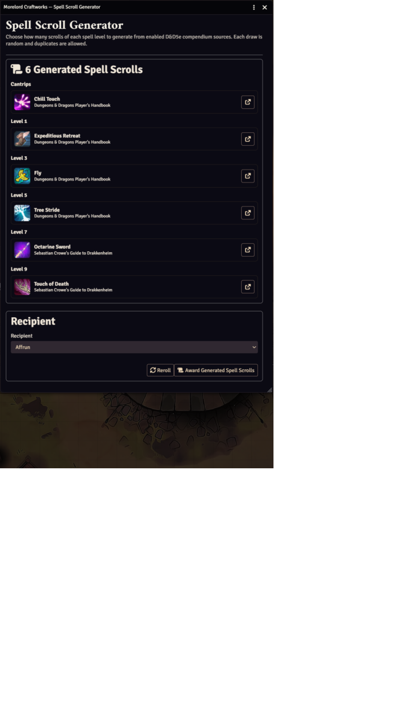

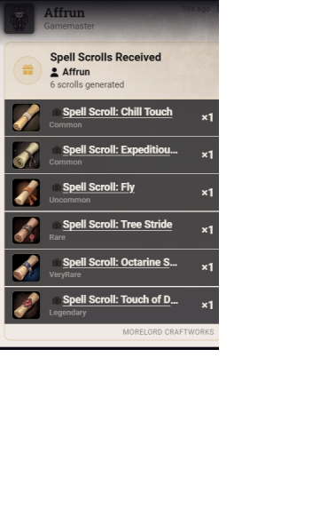

### Customize potion and scroll results

Use **Add Potion** or **Add Spell Scroll** in the results section to open the same full catalog picker used by custom recipes. Search by name and use the include/exclude filters for source, type, rarity or spell level, and potion category or school. All matching entries remain accessible through pagination. Source filters use Morelord Core book names, consolidating page references and generic pack labels while keeping editions distinct. The picker uses enabled sources and lets you choose entries outside the random-generation filters.

Use an item's trash button to remove that individual entry; duplicates are separate entries. An empty draft remains open so you can add replacements. Your Recipient selection stays selected while editing. Sharing and awarding use the edited draft; **Reroll** replaces it using the original generation settings.

### Spellbook Generator

1. Open **Spellbook Generator**.
2. Name the spellbook.
3. Enter the desired number of cantrips and spells at each level using the numeric fields or up/down controls.
4. Select **Generate**.
5. Inspect spell links and use **Reroll** if needed.
6. Choose a recipient.
7. Select **Create & Award Spellbook**.

Craftworks creates one custom spellbook Item containing clickable spell links and posts a public award card.

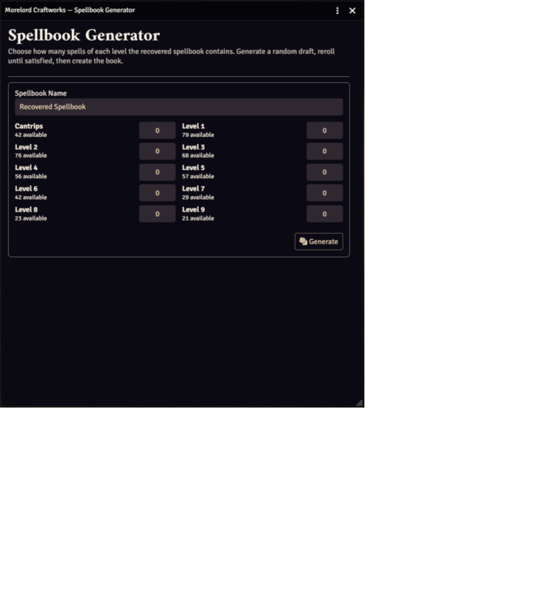

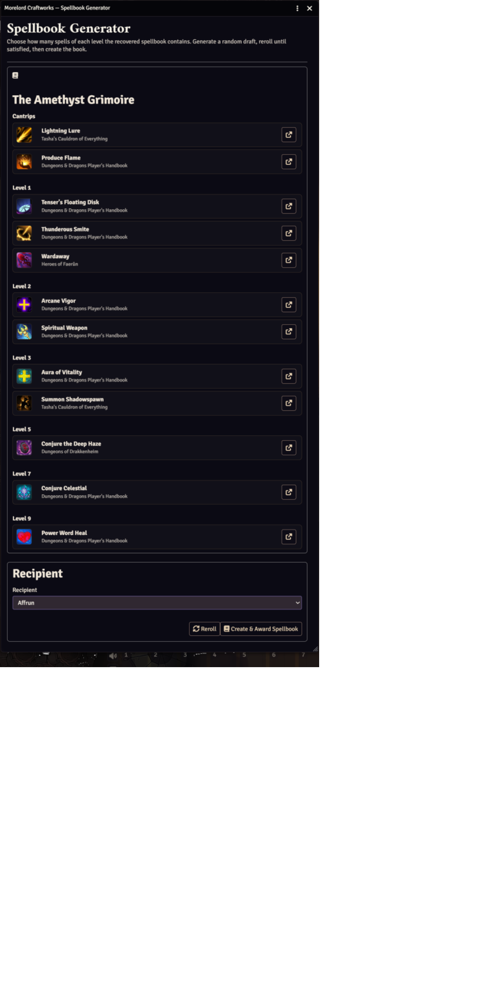

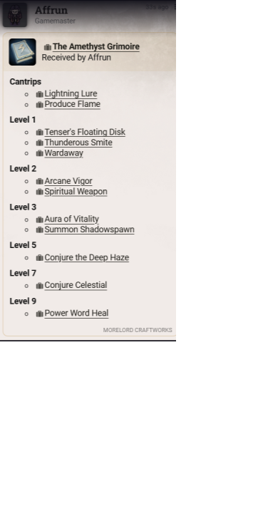

## Exceptional content: Monsters of Drakkenheim

The standard Craftworks experience does not depend on Drakkenheim. **Monsters of Drakkenheim** is an optional, exceptional content pack that demonstrates how deeply a supported setting can extend the same materials, recipes, acquisition, and crafting framework.

### Requirements

The enhanced experience requires:

- the **Drakkenheim** Craftworks Content Pack enabled
- a **Morelord Gaming Champion subscription**, connected to this world through Morelord Core
- the supported official Monsters of Drakkenheim Foundry content installed and available

Enabling the Craftworks pack does not provide or unlock the official source product. After installing or changing the source content, run **Sync with Compendiums**.

### What the pack adds

When its requirements are satisfied, the pack can contribute:

- Drakkenheim material families such as animus, bones, dust, fluid, hair, hide, natural weapons, and organs
- rarity-specific Drakkenheim materials
- exact creature-specific Harvestable Components data
- Drakkenheim recipes and ingredient relationships
- all 19 Appendix E SRD recipe variants for enhanced armor, shields, weapons, healing and resistance potions, and spell-scroll tiers
- Harvest, Gather, Loot, and other content definitions supplied by the pack
- special harvesting notes that do not fit the ordinary component-claim model

The Materials and Recipes browsers group Drakkenheim filters into concise top-level families, so users can explore the setting content without navigating an unmanageably long flat list.

Drakkenheim content is not isolated in a separate mode. When enabled, its materials, recipes, potions, and spells participate in the same searches and generators as other active sources. Results retain their source attribution: for example, a potion draft can mix core potions with **Trollblood Potion**, **Vampire Blood Potion**, and **Greater Rejuvenation Potion**, while scroll and spellbook drafts can include Drakkenheim spells beside core spells.

Recipe outputs prefer enabled premium PHB or DMG documents when the connected account has access, then fall back to SRD 5.2. Healing potions can also use SRD 5.1. Setting-specific recipes resolve finished items from the installed Dungeons of Drakkenheim, Monsters of Drakkenheim, and Sebastian Crowe's Guide to Drakkenheim Item compendiums. Enhanced armor, shield, and weapon recipes use the generic **+1, +2, or +3** source item; the GM configures the completed item as the intended equipment.

### Harvest recipe inventory counts

Marked recipe names in Harvest show this component’s inventory quantity / required quantity (for example, **2/4**). Inventory combines the harvesting character’s personal items with their party Group inventories; other characters’ inventories and unawarded claims are excluded. Repeated required ingredients are added together. For alternative recipe paths, the count uses the lowest quantity along a path that uses this component.

### Drakkenheim Harvest preflight

With the Drakkenheim content pack enabled and access available, Craftworks first reads the creature's own biography, including embedded journal pages, for a **Harvestable Components** section. It matches the listed components and rarity to canonical Craftworks materials. If the creature has no harvesting section, Craftworks checks its matching official compendium Actor; if neither has a section, standard harvesting applies. Review those matches in the GM preflight before starting the session.

Some creatures also include an **Items:** entry or special handling rule. Craftworks presents it as **Special Harvest Items / Instructions**. This information is intentionally GM-facing and informational: it calls attention to exceptional treasure or procedures outside the ordinary material reservation workflow.

Players work through one creature at a time, reserve available components, and select Next, Skip Remaining, or Done. Drakkenheim creatures require no Harvest skill check. Claimed components stay reserved until the GM finalizes awards.

### Graceful fallback

If the official Drakkenheim creature or harvesting data cannot be resolved, Craftworks falls back to standard harvesting where possible rather than making the creature unusable. Missing enhanced results should therefore be diagnosed as a content-pack, entitlement, source-installation, or synchronization issue—not as a requirement for ordinary Craftworks operation.

## Troubleshooting

When harvesting gives unexpected materials, use Core's **Download Troubleshooting File** before **Sync with Compendiums**, and download a second file afterward. With updated Core and Craftworks, the report includes pack configuration and access, catalog counts, known compendium availability and source filters, sync status, and recent harvest fallback reasons. It contains no creature identities or raw console logs. Recent outcomes reset when that client reloads; reproduce the issue and export from the GM client that performed the harvest.

### Materials or recipes are missing

- Confirm the corresponding Content Pack is enabled and available.
- Confirm required official content is installed.
- Check dnd5e **Configure Sources** for the expected Item compendium.
- Select **Sync with Compendiums** in Craftworks Settings.
- Reopen the browser after synchronization finishes.

### Premium content is locked

- Confirm Morelord Core is active.
- Use **Manage Account** in Craftworks Settings.
- Select **Refresh** after connecting or changing access.
- Confirm the desired Content Pack is enabled.

### A player does not receive Harvest or Gather

- For an offline character, use **Roll as GM** in the session progress list. For delivery to a player client, confirm the player is connected.
- Confirm the player has an assigned or owned character.
- Confirm SocketLib is active for the world.
- Confirm Craftworks is enabled and loaded for both clients.

### A Harvest claim did not add an item

Claims are reservations. Select **Finalize Harvest** to commit them to the resolved recipients.

### A generated reward is missing or cannot be awarded

Confirm its compendium remains enabled in dnd5e **Configure Sources**. Craftworks validates source availability when generating and again when awarding.

### Drakkenheim components are not appearing

- Confirm the **Drakkenheim** Content Pack is enabled.
- Confirm the connected account has the corresponding entitlement.
- Confirm the supported official source module is installed and active.
- Run **Sync with Compendiums** after changing content or access.
- Check the Harvest preflight for fallback standard components and any matching warnings.

### A crafting job is paused for the location

The Craft card shows **Paused - Environment** or **Environment Unavailable**, plus the location warning. Compare that activity and tier with the shared location for the viewed scene. An explicit Downtime location replaces that scene. A session set to **No Location** does not. **On the Road** has no facilities, and it applies only when the session has **No Location** and the viewed scene has no associated location. A warning that names a specialty, such as `Requires common workshop (Leatherworker's Tools or Any).`, needs that specialty or **Any** on a row of sufficient tier. A warning without parentheses needs only the activity and tier. See [Shared Locations](#shared-locations).

### A recipe reports missing materials

Check the selected **Ingredient Inventory**. A requirement can depend on canonical material identity, quantity, rarity, category, stage, tags, alternatives, or several units of the same material—not only the displayed item name.

## Support

Report reproducible problems at [Morelord Craftworks Issues](https://github.com/tmoreland72/morelord-craftworks/issues). Include Craftworks, Foundry, and dnd5e versions; the active content packs; relevant console errors; and steps to reproduce the problem.

## D&D 5e rarity compatibility

Potion, treasure, recipe, and material workflows accept legacy rarity fields and v6 rarity collections. Where one rarity is needed, the lowest listed rarity is used, matching the system Item getter. Existing items and recipe identifiers do not need a migration.

Generator category and school filters keep each checkbox with its label and wrap complete options as the window narrows.

Encounter Stories can open Hoard with a selected starting profile via `game.modules.get("morelord-craftworks").api.openHoard({ profileId: "5-10" })`. Existing calls without options still start at Challenge 0–4; unknown profile IDs use that default. This only opens the normal interface: the GM must generate, review, and award explicitly.
