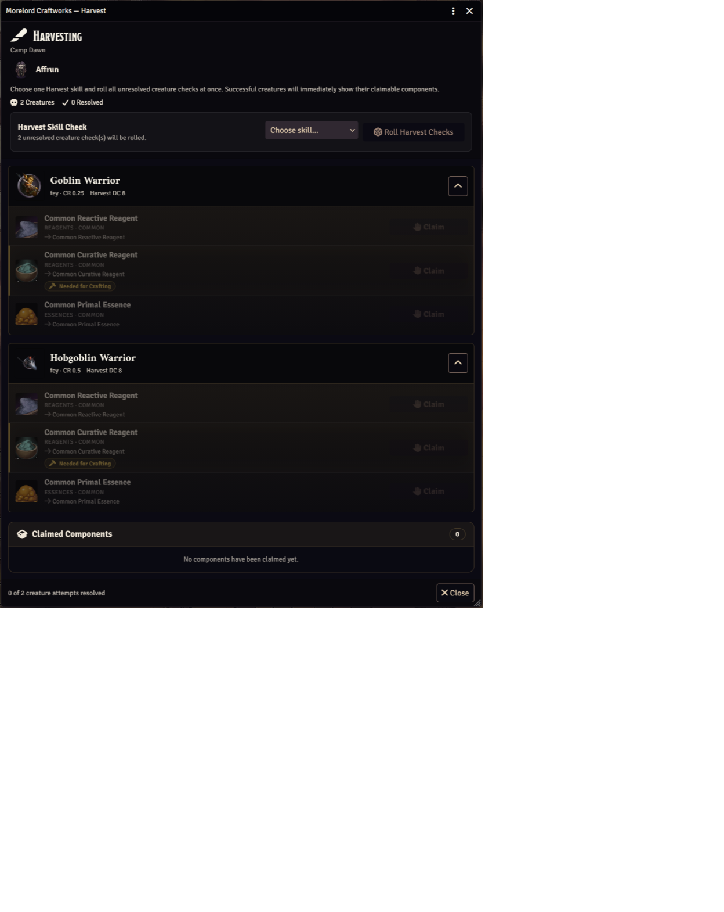
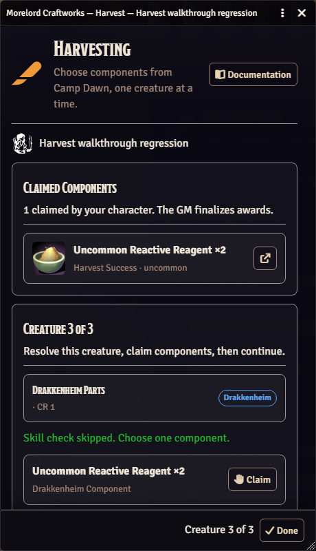
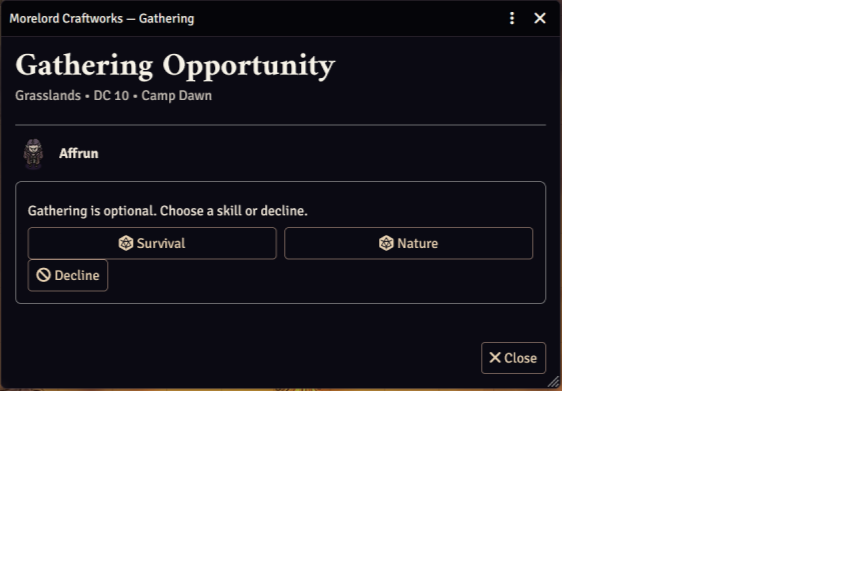
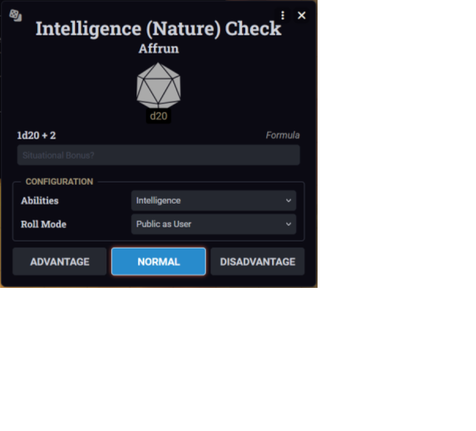
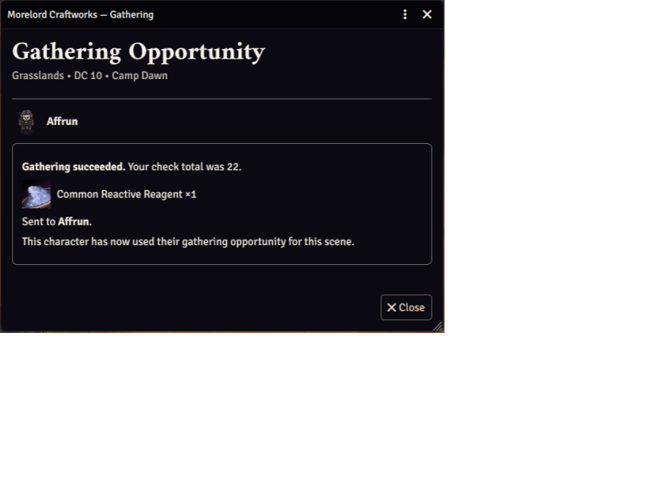

# Morelord Craftworks Player Manual

Morelord Craftworks lets you browse your campaign's materials and recipes, plan crafting projects, work from personal or shared inventories, and take part in Harvest and Gather sessions started by your Game Master.

This manual applies to Morelord Craftworks 0.5.2.

## Contents

- [Before you begin](#before-you-begin)
- [Open Craftworks](#open-craftworks)
- [Browse materials](#browse-materials)
- [Browse and learn recipes](#browse-and-learn-recipes)
- [Plan and complete crafting](#plan-and-complete-crafting)
- [Shared Locations](#shared-locations)
- [Participate in Harvest](#participate-in-harvest)
- [Participate in Gather](#participate-in-gather)
- [Understand awards and storage](#understand-awards-and-storage)
- [Optional Drakkenheim content](#optional-drakkenheim-content)
- [Troubleshooting](#troubleshooting)

## Before you begin

You normally need a character assigned to your Foundry user or an owned character token on the scene. Your GM controls the available Content Packs, recipe knowledge, acquisition settings, and whether acquired materials go to individual characters or a shared party Group actor.

Materials are normal dnd5e loot Items. Their Craftworks identity includes information such as rarity, category, processing stage, tags, and source pack, so a recipe may require more than an item with a similar name.

## Open Craftworks

1. Open **Morelord Tools** on the left side of the scene.
2. Select **Morelord Craftworks**.
3. Choose **Materials**, **Recipes**, or **Craft** from the dashboard.

The player dashboard shows that Craft section: **Materials**, **Recipes**, and **Craft**. Harvest and Gather windows open automatically when the GM starts a session in which your character can participate. Use **Documentation** at the top of the dashboard for the current in-Foundry guide.

## Browse materials

Open **Materials** to search the complete active material catalog. A material card can show its name, image, rarity, category, processing stage, value, acquisition methods, tags, and recipes that use it.

**Recipes (N)** opens **Recipes** filtered to the enabled recipes that accept this material. Matching includes a direct material ID, the material name, tags, category, stage, rarity, and alternative requirements. Drakkenheim components match by component family, specific part, creature type, and rarity rather than by a single material name. The button is omitted when no recipe you can see accepts the material. A recipe that only produces the material is listed under **Produced by** instead. **Clear all filters** in Recipes returns to the full catalog.

**Craftable** means an enabled recipe produces this material; **Produced by** lists its recipes. It does not indicate that your current inventory or character meets the crafting requirements. Standard **Gather**, **Harvest**, and **Loot** tags reflect active acquisition rules. GMs can click their orange source pills for details; players see passive reference tags.

Drakkenheim **Harvest** tags are verified by a connected GM using the same source check as the GM's browser. During **Checking monster harvest sources…**, or if verification fails, unverified Harvest tags stay hidden. Players receive only material availability; monster source details remain GM-only. Source changes refresh verified availability, and reopening Materials retries a failed check.

### Search and filters

Enter part of a name in Search or use facets such as Content Pack, rarity, category, stage, and material tag. Each facet cycles through three states:

| Symbol | State | Meaning |
| --- | --- | --- |
| Empty circle | Any | Do not filter on this value. |
| Plus | Include | Require this value. |
| Minus | Exclude | Hide results with this value. |

You can include several useful values while excluding unwanted families. Counts update against the complete catalog as you adjust the context. For responsiveness, Craftworks initially displays up to 300 matching cards even when the total is larger.

Use **Recipes (N)** on a material card to open the recipes that accept it, and use a recipe requirement image to open that material.

## Browse and learn recipes

Open **Recipes** to search available projects. Recipe cards can show the output, total crafting duration, required materials, tools, checks, recipe DCs, and whether your selected inventory currently satisfies each requirement.

### Known and Unknown recipes

- **Known** recipes display their ingredient requirements and can begin a new crafting job.
- **Unknown** recipes remain searchable and can be marked as goals, but their ingredients are concealed until the GM marks them Known.

Recipe rarity describes the public recipe or output rarity. It remains visible for an Unknown recipe and does not reveal its ingredient rarity.

### Find recipes you can make

The Recipes browser can filter by Content Pack, category, recipe rarity, ingredient rarity, ingredient material tag, knowledge, and inventory craftability. Enable **Only Show Craftable Recipes** to compare requirements with the current **Ingredient Inventory**.

Changing the search text or a facet updates the matching catalog and result count.

### Mark a goal

Use a recipe's crafting marker to add or remove it from your Craft list. You may mark an Unknown recipe as a future goal even though you cannot see its ingredients or start a new job yet.

In **Craft**, click the crafted item's image to open that recipe in **Recipes**, preserving the selected crafter. Click a specific ingredient's image to open its entry in **Materials**. The image buttons also support keyboard focus and activation. Generic requirements without one identifiable material retain a reference image.

## Plan and complete crafting

Open **Craft** to see recipes you marked for crafting and any active jobs. The window uses the same two-panel search-and-filter pattern as the reference browsers.

### Choose the crafter and inventory

- **Crafter** is the character doing the work. This actor supplies tool possession, tool proficiency, and check data.
- **Combined Ingredient Inventory** automatically includes that character and every Group they belong to. Materials can come from both inventories in one recipe.

You do not need to switch inventories to use party materials. Other characters’ inventories are excluded. Progress belongs to the crafter and recipe; the GM retains separate inventory controls.

### Read requirement status

Each ingredient row shows the amount available and required. Green counts satisfy a requirement; red counts do not. While a craft is in progress, ingredients already taken from inventory stay reserved for that craft. Each reserved ingredient shows a **Set aside for this craft** badge with the quantity held, and the Requirements section says: Materials are set aside, not lost, until the craft finishes or is abandoned. **Cancel** returns them. Requirements can identify:

- an exact Craftworks material
- a rarity, category, or processing stage
- one or more material tags
- alternative ingredients
- several units that must come from one matching material

Craftworks rolls the listed artisan tool at the recipe DC. Missing the tool in your crafter’s inventory or its proficiency imposes disadvantage, without changing the DC. Drakkenheim recipes require a Workshop matching or exceeding the item’s rarity. Bring the required materials and choose Craft Item; there is no crafting roll or time requirement, including for an older saved crafting project. [Shared Locations](#shared-locations) explains that Workshop, including Specialty.

### Make progress

Each crafting attempt represents two hours of work. A successful attempt adds progress. A failed check spends the two hours and does not advance the project. The materials and items already set aside for the project are not lost. They stay set aside for the next attempt. **Cancel** returns those materials and items to the inventories they came from. Some recipes define no check and advance through their own supported workflow.

Progress persists between attempts. Recipe cards display the total duration, and the active job records successful progress and total time spent. Successes never rise above the number required, including after a natural 20. When the finished item is placed, that recipe card returns to 0 successes, 0 hours of progress, and 0 hours spent so the next craft starts fresh. The craft log keeps the completed attempt. Downtime still counts the hours already spent.

Facility requirements, and what you see when a place blocks a job, are explained in [Shared Locations](#shared-locations). Crafting projects can also appear in Morelord Downtime and open directly into a focused Craftworks recipe view.

When the job completes, choose **Place in My Inventory** or **Place in {party name} Inventory**. **Place in My Inventory** adds the item to the crafter. **Place in {party name} Inventory** adds it to the party Group. A party member can use that button without owning the Group actor; a connected GM performs the inventory write. The button can be used once for that completed job. Foundry Item outputs use their live name and image and can be opened from their linked reference.

If you cancel an active job, Craftworks returns materials consumed when that job began to their original inventories.

Actual crafting execution requires the appropriate premium access. Standard users can still browse, evaluate requirements, mark goals, and review the Craft window.

## Shared Locations

Your GM decides whether a recipe needs a particular kind of place. Craftworks reads that place from Morelord Core’s shared locations. You use the place associated with the scene you are viewing. During an active Downtime session, a chosen session location replaces that scene. **No Location** keeps the scene’s place. **On the Road** applies when the session has **No Location** and the scene you are viewing has no associated place. On the Road has no facilities.

Recipe cards show a **Facility** line.

- `No facility required` means you can craft in any place, including On the Road.
- Otherwise the line names the item’s rarity and the activity your GM chose, such as `Uncommon or higher Forge` or `Common or higher Workshop (Leatherworker's Tools or Any)`.
- A higher rarity of that same activity qualifies. A Rare forge can craft an Uncommon item.
- A Workshop or Instructor line with no specialty in parentheses accepts any specialty of that activity. Parentheses name one required specialty. The place must include that specialty, or have nothing selected. Nothing selected means **Any**. A Specialty can list several choices, and the required one must be one of them. A Specialty saved as a single choice still matches that choice. **Any** stored next to other choices is ignored.
- Alchemist's Supplies and Poisoner's Kit, when your GM uses the standard assignment, need a Workshop whose Specialty includes Alchemist's Supplies or is **Any**. The warning reads `Requires common workshop (Alchemist's Supplies or Any).` for a Common item.
- A Forge line names the item you are making. A longsword reads `(Martial Melee Weapons or Any)`. Splint reads `(Heavy Armor or Any)`. Weapons, Martial Weapons, or Martial Melee Weapons on the Forge all cover a longsword. Armor or Heavy Armor covers splint. An item that is not armor, a weapon, or ammunition can use any Forge.
- After the dot, the card lists the current place’s specialties for that activity, separated by commas, or `Any` when none are selected.

In **Craft**, the same facts appear beside a location icon, using the stored words, such as `common workshop (Leatherworker's Tools or Any)` or `common workshop`.

When your current place does not qualify, the Craft card shows a warning such as `Requires common workshop.` or `Requires common workshop (Leatherworker's Tools or Any).`

- You have the materials and have not started: the badge reads **Environment Unavailable**, and the footer reads **Missing Requirements**.
- A job is already underway: the badge reads **Paused - Environment**, and **Roll Crafting Check** or **Craft Item** becomes **Paused here**. **Cancel** remains. Progress and materials already used stay as they are.
- Trying to start or continue shows the same warning sentence again.

When you are later at a place that meets the requirement, the crafting button returns. A job you have not started consumes no materials while it is blocked.

Your GM creates these places in Morelord Core. The **Shared Locations** section of the [Morelord Core documentation](https://morelordgaming.com/docs/morelord-core) explains that setup. The [GM manual](gm-manual.md#shared-locations) explains how each tool is checked.

## Participate in Harvest

Harvest begins when the GM selects defeated creatures and starts a synchronized session.

### Work through the creatures

1. Wait for the Harvest window to open.
2. Review the current creature in the larger right panel; your character’s claimed components appear on the left.
3. For a non-Drakkenheim creature, choose a skill and select **Roll Harvest Check** once for that creature. Drakkenheim creatures open directly to claims.
4. Claim your components, then select **Next** to replace this creature with the next one.

Each creature uses its own Harvest DC. A success reveals claimable components; a failure consumes your character's attempt for that creature. Previously attempted or resolved creatures are not rolled again. Reopening the window or retrying delivery reuses the recorded roll. If the GM enables **Skip Skill Checks** before starting, your window opens directly to component choices without a roll. Skipped checks do not grant a natural-20 bonus. The optional natural-20 bonus still allows two component claims on a successful harvest.

The GM chooses the characters included in the Harvest. Each character makes their own checks for non-Drakkenheim creatures; the GM can roll on behalf of offline players. If you control multiple included characters, Craftworks opens an independently titled Harvest window for each one; their checks and claims remain separate.

### Claim a component

Select one of the highlighted components after a success. If your natural d20 was 20 and the world setting permits it, you can receive a second claim or select **Next** to forgo it. The creature remains visible after claiming until you select **Next**. Select **Skip Remaining** to finish early, or **Done** on the last creature. Both notify the GM that your character completed harvesting and close the window without discarding your claims.

A claim is a reservation, not an immediate inventory award. Your character’s reservations appear in the left **Claimed Components** panel. Drakkenheim parts cannot be reserved by another character; standard components may be harvested independently. Materials connected to one of your marked recipes may display **Needed for Crafting**. Marked recipe names in Harvest show this component’s inventory quantity / required quantity (for example, **2/4**). Recipe badges show the name and quantity; hover for the full name. Inventory combines the harvesting character’s personal items with their party Group inventories; other characters’ inventories and unawarded claims are excluded. Repeated required ingredients are added together. For alternative recipe paths, the count uses the lowest quantity along a path that uses this component.

The GM must select **Finalize Harvest** before reserved items enter their resolved inventories. If the GM resets or cancels the session, unfinalized claims are discarded.

## Participate in Gather

Gather is an individual opportunity tied to the current scene and its terrain.

1. Wait for the GM to start Gather.
2. Review the terrain and displayed DC.
3. Choose an allowed Gathering skill.
4. Make the configured dnd5e roll, or decline the opportunity.
5. On a success, Craftworks awards an appropriate material from the active terrain content.

The GM selects participating characters using the same party-priority picker as Harvest. If you own multiple included characters, each receives an independently titled Gather window and a separate scene-tracked attempt.

An attempt is tracked for your character on that scene, so closing and reopening the application does not provide another roll. Your GM can reset the scene's Gather state when a new opportunity is appropriate.

## Understand awards and storage

Your GM can configure acquired Craftworks materials to go directly to participating characters or to a shared dnd5e Group actor. Loot and Hoard awards also let the GM choose a player character or Group actor as recipient.

When Craftworks commits an award, it posts a consolidated public chat card. The card can include the recipient, linked item names, images, rarities, quantities, and currency. Select a linked item to inspect its document.

Harvest is different while it is in progress: a component appears on the final award card only after the GM finalizes the session.

## Optional Drakkenheim content

Your campaign may enable the exceptional **Drakkenheim** Content Pack. It is additional content rather than a requirement for using Craftworks.

When available, you may encounter:

- Drakkenheim material families and rarities in the Materials browser
- recipes using setting-specific components
- creature-specific Harvest choices drawn from official Harvestable Components data
- special harvesting instructions presented by the GM

The normal Craftworks controls do not change. You still search with the same filters, mark recipes in the same way, make Harvest checks against individual creatures, reserve components, and receive them when the GM finalizes the session.

If the pack or its official source content is unavailable, Craftworks can use standard Harvest results where possible. Ask the GM about content access when you expected a setting-specific component but received the standard experience.

## Troubleshooting

### Craftworks does not show my character

- Select a token for a character you own.
- Ask the GM to assign your Foundry user a character.
- Ask the GM to verify your Owner permission.

### A material or recipe is missing

- Clear Search and active filters.
- Ask the GM whether the relevant Content Pack is enabled.
- Ask the GM to confirm the required official source is installed and selected in dnd5e **Configure Sources**. A recipe whose finished item comes from a source that is turned off there is hidden, and it returns when that source is turned back on.
- Ask the GM to run **Sync with Compendiums**.

### A recipe is Unknown

Unknown recipes intentionally conceal ingredients. You can mark one as a goal, but the GM must mark it Known before you can inspect its requirements or start a new job.

### Crafting says the place is unavailable

The Craft card shows a location warning such as `Requires common workshop.` or `Requires common workshop (Leatherworker's Tools or Any).` **Environment Unavailable** means you have the materials and have not started, and the current place does not qualify. **Paused - Environment** and **Paused here** mean a job you already started is waiting for that place. Progress already made is kept. Ask the GM which scene or Downtime location has the required facility. See [Shared Locations](#shared-locations).

### Craft says an ingredient is missing

Check the **Combined Ingredient Inventory** list and confirm your character belongs to the expected Group actor. A visually similar Item may not match the required canonical material, rarity, category, stage, tags, quantity, or same-material rule.

### The tool check has disadvantage

The **Crafter** must possess the required tool and have the necessary proficiency. Items stored only in the selected inventory actor do not replace the crafter's own tool context.

### My Harvest claim is not in inventory

This is expected until the GM selects **Finalize Harvest**. Claims only reserve components during the live session.

### Gather says this character already attempted

Gather opportunities are tracked per character and scene. The GM must reset the scene's Gather state before the character can try again.

## Getting help

Ask your GM first about enabled content, recipe knowledge, shared storage, and acquisition settings. Reproducible module problems can be reported at [Morelord Craftworks Issues](https://github.com/tmoreland72/morelord-craftworks/issues).

## Delerium Search

When the GM starts a supported Drakkenheim search, selected connected characters can roll Arcana, Investigation, or Survival. Follow the search window to roll or decline. The GM finalizes the search and awards compendium delerium to a character or party Group using Recipient.
